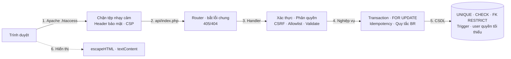

# Bảo mật & Xử lý phi chức năng — Hệ thống Quản lý Học phí Sinh viên

| | |
| --- | --- |
| Cập nhật | 14/11/2026 |
| Phạm vi | Cách hệ thống **hiện thực** các yêu cầu phi chức năng: bảo mật, toàn vẹn dữ liệu (transaction, idempotency), hiệu năng, tin cậy, khả dụng, bản địa hóa. Có kết quả kiểm chứng và các điểm còn tồn đọng. |
| Chỉ tiêu đo được | [DAC_TA_YEU_CAU.md §1](DAC_TA_YEU_CAU.md#1-yêu-cầu-phi-chức-năng) (NFR-SEC/PERF/USE/LOC/REL) |
| Lệnh kiểm chứng | `tests\run.php` (346 test), `tests\security_scan.php` (64 kiểm tra), `tests\perf.php` (37 thao tác) |

**Tóm tắt trạng thái**

| Hạng mục | Kết quả gần nhất |
| --- | --- |
| Quét bảo mật | 63 PASS · **0 FAIL** · 2 WARN (cookie `Secure` cần HTTPS; `simulation_enabled` đang bật cho demo) |
| XSS trên trình duyệt thật | 5 payload: 0 thẻ bị chèn, 0 thuộc tính `on…`, 0 vi phạm CSP |
| Hiệu năng (1 người dùng) | Mọi thao tác < 200 ms; chậm nhất là đăng nhập 107 ms |
| Kiểm thử hồi quy | Backend 346/346 · Frontend 30/30 |
| Tồn đọng | 10 mục, xem [§9](#9-tồn-đọng-và-đề-xuất) |

---

## 1. Mô hình phòng thủ



Nguyên tắc: **mọi quyết định bảo mật và tính tiền đều nằm ở máy chủ**. Kiểm tra phía trình duyệt chỉ để trải nghiệm tốt hơn (báo lỗi sớm), không bao giờ được tin cậy.

---

## 2. Bảo mật

### 2.1 Xác thực & phiên

| Biện pháp | Hiện thực | Vị trí | Kiểm chứng |
| --- | --- | --- | --- |
| Băm mật khẩu | bcrypt **cost 11** (`hash_password()`); hash cũ khác cost **tự băm lại** khi đăng nhập thành công | [api/lib/config.php](../api/lib/config.php), `login_user()` | NFR-SEC-11 |
| Không dò được tài khoản | Cùng thông báo "Sai tên đăng nhập hoặc mật khẩu."; user không tồn tại vẫn chạy `password_verify()` với `DUMMY_PASSWORD_HASH` **cùng cost** | `login_user()` | TC-24-03, TC-24-04; chênh lệch thời gian đo được **1 ms** |
| Khóa tài khoản | Sai **5** lần → khóa **15** phút (đọc từ config) | `login_user()` | TC-13-05…07, TC-22-43 |
| Giới hạn tần suất | **30** lần `/api/login` / 60 s / IP → 429 + header `Retry-After`; bộ đếm theo file, có `flock()`; header test từ IP ngoài không nới được giới hạn | [api/lib/rate_limit.php](../api/lib/rate_limit.php) | TC-33-01…05 (kể cả 40 request song song → đúng 30 qua) |
| Chống session fixation | `session_regenerate_id(true)` sau khi đăng nhập và sau khi đổi mật khẩu | `login_user()`, `student.php` | — |
| Cookie phiên | `TUITION_SESSID`: `HttpOnly`, `SameSite=Strict`, không `Expires` (mất khi đóng trình duyệt), `Secure` tự bật khi chạy HTTPS | `start_session_safe()` | SEC [2] |
| Hết hạn phiên | Rảnh **30 phút** → 401 `SESSION_EXPIRED`; tối đa **8 giờ** → 401 `SESSION_MAX_LIFETIME`; đăng nhập lại với cookie cũ đã hết hạn vẫn thành công | `start_session_safe()` | TC-31-02, TC-31-03 |
| Đăng xuất khi đóng tab cuối | `BroadcastChannel` đếm số tab; tab cuối đóng → `navigator.sendBeacon` gửi `logout_token` (token riêng, khác CSRF) | `main.js`, `/api/logout-beacon` | TC-31-04…07 |
| Mật khẩu tạm | 12 ký tự, đủ hoa/thường/số/ký tự đặc biệt, `random_int()`; bắt buộc đổi trước khi dùng (`PASSWORD_CHANGE_REQUIRED`) | `generate_student_temporary_password()` | TC-22-01, TC-22-05…11 |

### 2.2 Phân quyền

| Biện pháp | Hiện thực | Kiểm chứng |
| --- | --- | --- |
| Theo vai trò | `require_admin()` ở đầu mọi handler quản trị; `require_student()` cho `/api/student/*`. Sai vai trò → 403 | TC-22-40, TC-22-41, TC-26-08, TC-26-09 |
| Cô lập dữ liệu sinh viên | Mọi truy vấn của cổng SV lọc theo `student_id` **lấy từ phiên**, không bao giờ từ request; body chứa `student_id` → 400; dữ liệu của SV khác → **404** (không lộ là có tồn tại) | TC-22-35…38, TC-28-06, TC-28-09, TC-30-08 |
| Maker-checker | Người duyệt hoàn tiền ≠ người lập → 403; vi phạm được ghi log | TC-05-03, TC-21-07, TC-21-08 |
| Không "đoán" người dùng | `current_user_id()`: thiếu phiên → 401 (thay cho `?? 1` cũ) | — |

### 2.3 Chống tấn công web

| Tấn công | Biện pháp | Vị trí | Kiểm chứng |
| --- | --- | --- | --- |
| **SQL injection** | 100% truy vấn dùng prepared statement thật (`ATTR_EMULATE_PREPARES = false`) | [api/lib/db.php](../api/lib/db.php), handlers | SEC [5]: 6 payload, 0 lộ dữ liệu / 0 lỗi 500 / không bị trễ |
| **XSS** | Lớp 1: `escapeHTML()` (mã hóa `& < > " '`) trước mọi `innerHTML`, `textContent` cho ô biên lai/hóa đơn, `htmlspecialchars(ENT_QUOTES)` cho hóa đơn tải về. Lớp 2: CSP `script-src 'self'` chặn mọi script inline và thuộc tính `on…`. Lớp 3: API trả `application/json` + `nosniff` | `main.js`, `calc.js`, `student.php`, `.htaccess` | Rà 60 chỗ `innerHTML`; thử trên Chrome thật với 5 payload: **0** phần tử bị chèn, **0** vi phạm CSP |
| **CSRF** | Token ngẫu nhiên 32 byte (256 bit) theo phiên, gửi qua header `X-CSRF-Token`, so bằng `hash_equals()`; cộng thêm `SameSite=Strict` | [api/lib/csrf.php](../api/lib/csrf.php) | TC-13-03, TC-13-04, TC-22-42, SEC [4] |
| **Mass assignment** | Mỗi endpoint có danh sách trường cho phép (`validate_allowed_fields()`); trường lạ → 400 | `validate.php` | SEC [5], TC-22-38 |
| **Clickjacking** | `X-Frame-Options: DENY` + CSP `frame-ancestors 'none'` | `.htaccess` | SEC [2] |
| **Truy cập tệp nhạy cảm** | `.htaccess` chặn `config/`, `database/`, `logs/`, `api/lib`, `api/handlers`, `tests/*.php`, tệp `.sql/.log/.ini/.env/.md`, mọi tệp ẩn (`.git`, `.gitignore`); tắt liệt kê thư mục | `.htaccess`, `config/.htaccess` | SEC [1]: 17/17 → 403 |
| **Lộ thông tin** | Không in lỗi PHP ra client; lỗi bất ngờ → thông báo chung, chi tiết ghi `logs/app_error.log`; ẩn `X-Powered-By`; sai method → 405, sai đường dẫn → 404 dạng JSON | `api/index.php`, `.htaccess` | TC-23-03, SEC [6] |
| **Request quá lớn / sai định dạng** | Body ≤ 64 KB (413); JSON hỏng → 400; tự bỏ BOM; kiểu dữ liệu sai (mảng thay chuỗi) → 400 | `get_json_input()`, handlers | SEC [5] |
| **Cross-origin** | Không có header CORS → trình duyệt chỉ cho chính site gọi API | — | — |

### 2.4 Dữ liệu nhạy cảm

| Dữ liệu | Xử lý |
| --- | --- |
| Mật khẩu | Chỉ lưu hash bcrypt; không bao giờ trả về trong API; không ghi vào audit log |
| Thẻ thanh toán | Kiểm tra Luhn/hạn/CVV rồi bỏ; chỉ lưu **thương hiệu + 4 số cuối**; frontend xóa ô nhập ngay khi gửi. Đã kiểm 0 lần xuất hiện số thẻ đầy đủ/CVV trong DB, log, phản hồi, HTML hóa đơn (TC-28-26, TC-30-09) |
| Cấu hình DB | `config/config.php` nằm trong `.gitignore` và bị chặn truy cập qua web; ứng dụng dùng user `tuition_user` chỉ có SELECT/INSERT/UPDATE/DELETE |

### 2.5 Cửa dành cho kiểm thử và chế độ mô phỏng

| Hạng mục | Cách kiểm soát |
| --- | --- |
| Header test (`X-Tuition-Test-Db`, `X-Simulation-Enabled`, `X-Simulate-Gateway-Fail`, `X-Test-Force-Exception`) | Chỉ được chấp nhận qua `is_test_request()` / `get_test_header()`: phải đúng giá trị **và** đến từ `127.0.0.1`/`::1`. `security_scan.php` kiểm tra không còn đoạn code nào đọc header test trực tiếp |
| Thanh toán mô phỏng | Mọi kênh giả (xác nhận QR, thẻ test, endpoint cũ) đi qua `require_simulation_enabled()`. Thiếu cấu hình thì mặc định **tắt**; đã kiểm: khi tắt, cả 3 trả 404 |

### 2.6 Nhật ký kiểm toán

`log_audit()` ghi `user_id`, hành động, đối tượng, dữ liệu JSON và IP cho: đăng nhập thành công/thất bại (kèm lý do), đăng xuất, thêm/sửa/xóa danh mục, thu tiền, đảo bút toán, chuyển tiền, lập/duyệt/hủy hoàn tiền, cấp/đặt lại tài khoản, đổi mật khẩu. Nhật ký ghi **cùng transaction** với thao tác tiền nên không có chuyện có giao dịch mà thiếu nhật ký. Bảng chỉ thêm, không sửa (ngoại lệ: xóa sinh viên chưa có hồ sơ thì gán `user_id = NULL`).

---

## 3. Toàn vẹn dữ liệu: Transaction

### 3.1 Cơ chế

```php
$result = db_transaction(function (PDO $pdo) {
    // nhiều lệnh SQL – hoặc thành công hết, hoặc không có gì xảy ra
});
```

| Tình huống | `db_transaction()` ([db.php](../api/lib/db.php)) |
| --- | --- |
| Thành công | `COMMIT` |
| Bất kỳ lỗi nào | `ROLLBACK` rồi ném lỗi tiếp |
| Deadlock (1213 / 40001) | `ROLLBACK`, chờ 50 ms, thử lại **1** lần |
| `json_error()` giữa chừng (gọi `exit`) | Không commit → MySQL tự rollback khi kết nối đóng |

CSDL: InnoDB, mức cô lập **REPEATABLE READ**, `innodb_lock_wait_timeout = 50` giây.

### 3.2 Khóa bi quan (`SELECT … FOR UPDATE`)

| Đối tượng bị khóa | Mục đích |
| --- | --- |
| Dòng `fee_records` | Thu tiền, đảo bút toán, chuyển tiền, hoàn tiền trên cùng hồ sơ phải xếp hàng; số nợ luôn được tính lại **sau khi** đã khóa |
| `receipt_counters` / `bill_counters` | Số `PT-…` / `HD-…` không trùng, không nhảy |
| Phiếu gốc khi đảo, yêu cầu hoàn tiền, phiên QR | Không đảo 2 lần, không duyệt và hủy cùng lúc, không xác nhận QR 2 lần |
| 2 hồ sơ khi chuyển tiền | Luôn khóa theo **id tăng dần** để không deadlock khi A→B và B→A chạy cùng lúc |

### 3.3 Ví dụ: thu 1 khoản tiền

```text
BEGIN
  khóa hồ sơ (FOR UPDATE) → kiểm tra request_id → tính lại còn nợ
  → khóa bộ đếm, cấp số PT- → INSERT sổ cái → INSERT hóa đơn (nếu SV) → INSERT audit_log
COMMIT          (lỗi ở bất kỳ bước nào → ROLLBACK toàn bộ)
```

Cổng thanh toán thẻ được gọi **trước** khi mở transaction, nên DB không bị khóa trong lúc chờ phía ngoài.

### 3.4 Ràng buộc ở mức CSDL (lớp bảo vệ cuối)

`UNIQUE` (mã SV, username, 1 hồ sơ/SV/học kỳ, `request_id`, `receipt_no`, `bill_no`, `reverses_entry_id`), `CHECK` (số tiền > 0, miễn giảm 1–100%, vai trò ↔ `student_id`), khóa ngoại `RESTRICT`, trigger viết hoa mã SV. Chi tiết: [ERD.md](ERD.md).

### 3.5 Kiểm chứng

TC-09-01 (2 tiến trình cùng thu vượt nợ → đúng 1 thành công), TC-16-03/04 (tạo trùng hồ sơ đồng thời), TC-16-10 (duyệt đồng thời 2 hoàn tiền), TC-02-03 / TC-22-25 / TC-30-03 (bị từ chối hoặc cổng lỗi → sổ cái không đổi).

---

## 4. Toàn vẹn dữ liệu: Idempotency

Mỗi yêu cầu ghi tiền mang một **idempotency key** `request_id` (UUID). Gửi 1 lần hay nhiều lần cho kết quả như nhau.

| Lớp | Hiện thực |
| --- | --- |
| Client | `crypto.randomUUID()`; nút gửi bị khóa trong lúc chờ |
| Kiểm tra trước | Đã có bản ghi với `request_id` → trả **bản ghi cũ, HTTP 200** (lần đầu là 201) |
| CSDL | Cột `request_id` `UNIQUE` |
| Tranh chấp | 2 request trùng đến cùng lúc → request sau gặp lỗi trùng khóa `23000` → đọc lại và trả bản ghi của request trước |

Áp dụng cho: thu tiền, đảo bút toán, chuyển tiền (cặp bút toán), lập hoàn tiền, đăng ký tín chỉ, thanh toán SV, tạo phiên QR, thanh toán thẻ, hóa đơn. Kiểm chứng: TC-07-01…03, TC-16-16/17, TC-22-17, TC-22-27, TC-28-07, TC-28-25, TC-30-04.

---

## 5. Hiệu năng

### 5.1 Biện pháp

| Biện pháp | Tác dụng |
| --- | --- |
| Truy vấn tổng hợp công nợ quét `ledger_entries` **1 lần** (thay vì 4) và `refund_requests` **1 lần** (thay vì 2) | Giảm tải cho mọi API danh sách và mọi lần thu tiền |
| Không lưu số dư; MariaDB tự lọc sớm khi chỉ cần 1 hồ sơ | Tổng hợp 1 hồ sơ ≈ 0,6 ms |
| bcrypt **cost 11** | Đăng nhập ~100 ms (cost 12 mất ~180 ms) |
| Nén **gzip** phản hồi JSON (khi trình duyệt hỗ trợ) | Danh sách 9,5 MB → 494 KB qua mạng |
| Tìm sinh viên trả tối đa 20 kết quả; combobox debounce 300 ms; poll QR 3 giây/lần | Giảm số request và kích thước phản hồi |
| 1 kết nối DB / request; `app_config()` đọc 1 lần | Tránh mở lại kết nối và đọc lại tệp |

### 5.2 Kết quả (`tests/perf.php`, 1 người dùng, lần chậm nhất)

| Nhóm | Ngưỡng | Đo được |
| --- | --- | ---: |
| Tải cả trang (HTML + CSS + 4 JS) | < 200 ms | 15 ms |
| Đăng nhập | < 200 ms | 107 ms |
| 15 API đọc | < 200 ms | 46 ms |
| 14 thao tác ghi | < 200 ms | 44 ms |
| *Tham khảo:* 50 người dùng đồng thời | — | p95 41 ms, ~1.200 req/s, 0 lỗi |

---

## 6. Tin cậy & vận hành

| Hạng mục | Hiện thực |
| --- | --- |
| Sổ cái chỉ thêm | Hủy phiếu = thêm bút toán `reversal` đối ứng; không có UPDATE/DELETE trên `ledger_entries`, `bills` |
| Số liệu luôn cân bằng | Số dư luôn tính lại từ sổ cái; `Đã thu + Còn phải thu = Tổng phải thu` được kiểm ở mọi phạm vi (TC-12-02, TC-27-03) |
| Lỗi cổng thanh toán | Timeout/từ chối → 502/422, **không** ghi sổ cái, **không** sinh hóa đơn |
| Bắt lỗi chung | `set_exception_handler`: ghi chi tiết vào `logs/app_error.log`, trả thông báo chung |
| Cài đặt lặp lại được | Nạp lại `schema.sql` + `seed.sql` + `seed_users.php` 2 lần liên tiếp không lỗi (TC-32-06); `database.sql` sinh tự động từ 3 tệp gốc |
| Kiểm thử hồi quy | 346 test tích hợp (database riêng `tuition_test`) + 30 test frontend + quét bảo mật + đo hiệu năng |

---

## 7. Khả dụng

- **Lỗi hiện đúng chỗ:** API trả `error.fields` theo từng trường, giao diện tô đỏ ô lỗi, hiện thông báo ngay bên dưới và focus vào ô lỗi đầu tiên (35 test nhóm 18).
- **Chống thao tác lặp:** nút bị khóa trong lúc gửi, kết hợp idempotency key.
- **Giữ dữ liệu khi lỗi:** mất mạng hoặc máy chủ lỗi thì form giữ nguyên, có thông báo tiếng Việt; request quá 15 giây tự hủy.
- **Điều hướng:** URL dạng hash, nút Back/Forward hoạt động; đăng xuất rồi bấm Back không lộ dữ liệu cũ.
- **Hiển thị:** responsive tới 360 px; biên lai/hóa đơn in vừa 1 trang A4.

## 8. Bản địa hóa

- **Giao diện và thông báo:** toàn bộ tiếng Việt.
- **Unicode:** `utf8mb4`, chuẩn hóa NFC, họ tên tới 100 ký tự.
- **Tìm kiếm không dấu:** cột `name_search`, `nguyen` tìm được `Nguyễn`.
- **Tiền:** nhập theo thói quen Việt Nam (`1.500.000`, `1,500,000`, `1 500 000`, `₫1.500.000`); hiển thị `1.500.000 ₫`; đọc số thành chữ tiếng Việt trên biên lai.
- **Ngày giờ:** nhận `dd/mm/yyyy`, lưu ISO; PHP và MySQL cùng múi giờ `Asia/Ho_Chi_Minh` (+07:00).

---

## 9. Tồn đọng và đề xuất

| # | Mức | Vấn đề | Đề xuất |
| ---: | --- | --- | --- |
| 1 | **Cao** (khi chạy thật) | `simulation_enabled = true` (cần cho demo QR); mật khẩu DB và tài khoản mẫu là công khai trong repo; chưa có HTTPS | Trước khi chạy thật: đặt `false`, đổi mọi mật khẩu, cấu hình HTTPS |
| 2 | Trung bình | **Idempotency key được sinh lại ở mỗi lần bấm** (`main.js`). Mất phản hồi sau khi server đã ghi, người dùng bấm lại → UUID mới → có thể **thu 2 lần** | Sinh UUID khi mở form, giữ nguyên qua các lần thử lại, chỉ đổi khi lưu thành công/đóng form |
| 3 | Trung bình | **Đặt/bỏ miễn giảm** và **sửa số tín chỉ** (admin) không nằm trong transaction và không khóa hồ sơ. `FOR UPDATE` ở `PUT /api/fee-records/{id}` chạy ở autocommit nên vô tác dụng | Bọc trong `db_transaction()` + khóa `fee_records … FOR UPDATE`; thêm test đồng thời "thu tiền + đổi miễn giảm" |
| 4 | Thấp | Gửi lại cùng `request_id` nhưng **khác nội dung** vẫn nhận bản ghi cũ với 200 | Lưu "dấu vân tay" của body; trùng mã mà khác nội dung → 422 |
| 5 | Thấp | CSP còn `style-src 'unsafe-inline'` (116 thuộc tính `style="…"`) | Chuyển style sang `style.css`, bỏ `'unsafe-inline'` |
| 6 | Thấp | Bộ đếm rate limit lưu theo file trong thư mục tạm nên chỉ đúng với 1 máy chủ; tệp đếm cũ không tự dọn; chỉ áp dụng cho `/api/login` | Dùng bảng DB/Redis nếu chạy nhiều máy chủ; dọn tệp định kỳ |
| 7 | Thấp | Khóa tài khoản trả 409 khác 401, nên vẫn xác nhận được tài khoản tồn tại; kẻ xấu có thể cố ý khóa `admin` | Cân nhắc cùng một thông báo; dùng CAPTCHA hoặc trễ tăng dần thay vì khóa cứng |
| 8 | Thấp | API danh sách không phân trang. Với ~5.000 sinh viên, `/api/fee-records` mất ~340–630 ms và nặng 9,5 MB | Phân trang `/api/fee-records`, `/api/students`, `/api/history` |
| 9 | Thấp | Tệp JS/CSS gửi kèm `Cache-Control: no-store`, nên mỗi lần mở trang đều tải lại ~300 KB JS/CSS | Bỏ `no-store` cho tệp tĩnh (đã có `?v=` để cập nhật phiên bản) |
| 10 | Thấp | Chưa có sao lưu CSDL tự động | Lập lịch `mysqldump` hằng ngày + kiểm tra khôi phục định kỳ |
