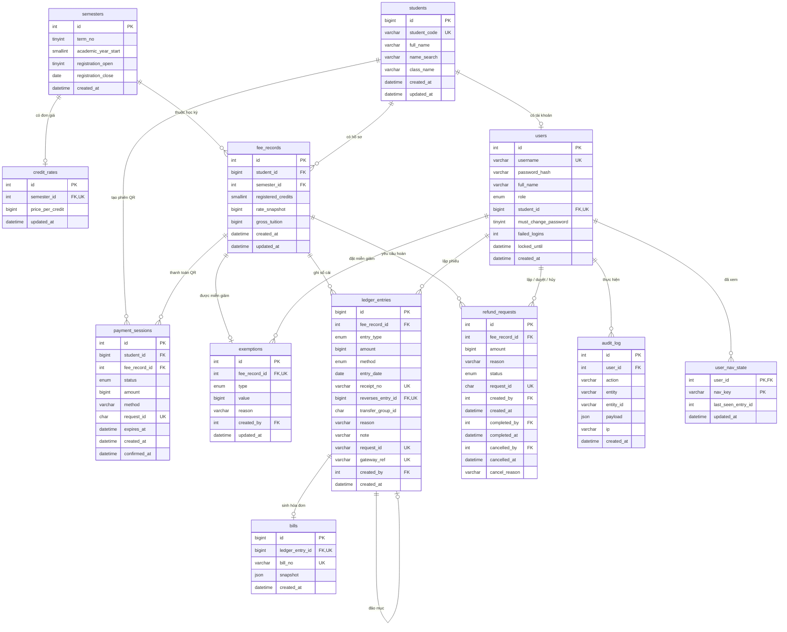

# ERD — Mô hình dữ liệu Hệ thống Quản lý Học phí Sinh viên

| | |
| --- | --- |
| Nguồn | [database/schema.sql](../database/schema.sql) (MariaDB 10.x / MySQL 8, InnoDB, `utf8mb4_unicode_ci`) |
| Phiên bản | 14/11/2026 — 15 bảng, 2 trigger |
| Liên quan | [Phân tích & Thiết kế](PHAN_TICH_THIET_KE.md) · [Đặc tả yêu cầu](DAC_TA_YEU_CAU.md) |

Ký hiệu: **PK** khóa chính · **FK** khóa ngoại · **UK** duy nhất · **NN** bắt buộc (NOT NULL) · **CK** ràng buộc CHECK.

---

## 1. Sơ đồ tổng quan

**Bảng độc lập** (không có quan hệ khóa ngoại):

| Bảng | Vai trò |
| --- | --- |
| `receipt_counters` | Bộ đếm số biên lai `PT-YYYYMMDD-NNNN`, 1 dòng mỗi ngày |
| `bill_counters` | Bộ đếm số hóa đơn `HD-YYYYMMDD-NNNN`, 1 dòng mỗi ngày |
| `student_settings` | Cấu hình 1 dòng duy nhất (`id = 1`): số tín chỉ tối thiểu/tối đa sinh viên được đăng ký |

---

## 2. Quan hệ và lực lượng

| # | Quan hệ | Lực lượng | Khóa ngoại | Khi xóa / sửa cha | Ý nghĩa nghiệp vụ |
| ---: | --- | --- | --- | --- | --- |
| R1 | `semesters` → `credit_rates` | 1 : 0..1 | `credit_rates.semester_id` (UK) | RESTRICT | Mỗi học kỳ có tối đa 1 đơn giá tín chỉ |
| R2 | `semesters` → `fee_records` | 1 : 0..n | `fee_records.semester_id` | RESTRICT | Không xóa được học kỳ đã có hồ sơ |
| R3 | `students` → `fee_records` | 1 : 0..n | `fee_records.student_id` | RESTRICT | Không xóa được sinh viên đã có hồ sơ |
| R4 | `students` → `users` | 1 : 0..1 | `users.student_id` (UK) | RESTRICT | Mỗi sinh viên tối đa 1 tài khoản |
| R5 | `fee_records` → `exemptions` | 1 : 0..1 | `exemptions.fee_record_id` (UK) | RESTRICT | Mỗi hồ sơ tối đa 1 miễn giảm (sửa = ghi đè) |
| R6 | `fee_records` → `ledger_entries` | 1 : 0..n | `ledger_entries.fee_record_id` | RESTRICT | Mọi biến động tiền của hồ sơ |
| R7 | `fee_records` → `refund_requests` | 1 : 0..n | `refund_requests.fee_record_id` | RESTRICT | Các yêu cầu hoàn tiền |
| R8 | `fee_records` → `payment_sessions` | 1 : 0..n | `payment_sessions.fee_record_id` | **CASCADE** | Phiên QR là dữ liệu tạm, xóa theo hồ sơ |
| R9 | `students` → `payment_sessions` | 1 : 0..n | `payment_sessions.student_id` | **CASCADE** | Dùng để kiểm tra chủ sở hữu phiên |
| R10 | `ledger_entries` → `ledger_entries` | 1 : 0..1 | `reverses_entry_id` (UK) | RESTRICT | Dòng `reversal` trỏ về phiếu gốc; UK → mỗi phiếu đảo tối đa 1 lần |
| R11 | `ledger_entries` → `bills` | 1 : 0..1 | `bills.ledger_entry_id` (UK) | RESTRICT | Mỗi khoản thu của sinh viên có đúng 1 hóa đơn |
| R12 | `users` → `ledger_entries` | 1 : 0..n | `ledger_entries.created_by` | RESTRICT | Người lập phiếu |
| R13 | `users` → `exemptions` | 1 : 0..n | `exemptions.created_by` | RESTRICT | Người đặt miễn giảm |
| R14 | `users` → `refund_requests` | 1 : 0..n (×3) | `created_by`, `completed_by`, `cancelled_by` | RESTRICT | Người lập, người duyệt, người hủy |
| R15 | `users` → `audit_log` | 0..1 : 0..n | `audit_log.user_id` (NULL được) | RESTRICT | NULL khi chưa đăng nhập (vd đăng nhập sai) |
| R16 | `users` → `user_nav_state` | 1 : 0..n | `user_nav_state.user_id` | RESTRICT | Mốc "đã xem" cho badge menu |

Hai mối nối khóa kép **suy ra từ ràng buộc**, không có khóa ngoại riêng:
- `fee_records (student_id, semester_id)` là UK → mỗi sinh viên chỉ có 1 hồ sơ cho mỗi học kỳ. Đây là quan hệ nhiều-nhiều giữa `students` và `semesters`, với `fee_records` là bảng liên kết mang thuộc tính.
- `ledger_entries.transfer_group_id` nối cặp dòng `transfer_out` / `transfer_in` của cùng một lần chuyển tiền (có chỉ mục `idx_ledger_transfer_group_id`).

---

## 3. Từ điển dữ liệu

### 3.1 `semesters` — Học kỳ

| Cột | Kiểu | Ràng buộc | Mô tả |
| --- | --- | --- | --- |
| `id` | INT | PK, auto | |
| `term_no` | TINYINT | NN; API giới hạn 1–3 | Học kỳ trong năm (3 = học kỳ hè) |
| `academic_year_start` | SMALLINT | NN | Năm bắt đầu năm học (2026 → "2026-2027") |
| `registration_open` | TINYINT(1) | NN, mặc định 0 | 1 = sinh viên được tự đăng ký tín chỉ |
| `registration_close` | DATE | NULL | Hạn cuối đăng ký; NULL = không giới hạn |
| `created_at` | DATETIME | NN, mặc định NOW | |
| | | **UK** `uq_semester(term_no, academic_year_start)` | Không trùng học kỳ |

### 3.2 `students` — Sinh viên

| Cột | Kiểu | Ràng buộc | Mô tả |
| --- | --- | --- | --- |
| `id` | BIGINT | PK, auto | |
| `student_code` | VARCHAR(12) | NN, **UK**; API: 6–12 chữ/số | Mã sinh viên; **trigger** tự `UPPER(TRIM())` khi thêm/sửa |
| `full_name` | VARCHAR(100) | NN; API: 1–100 ký tự Unicode, chuẩn hóa NFC | Họ tên |
| `name_search` | VARCHAR(255) | NN, chỉ mục `idx_students_name_search` | Họ tên bỏ dấu, viết thường — dùng cho tìm kiếm không dấu |
| `class_name` | VARCHAR(50) | NULL | Lớp; chuỗi rỗng lưu thành NULL |
| `created_at`, `updated_at` | DATETIME | NN, tự cập nhật | |

### 3.3 `users` — Tài khoản đăng nhập

| Cột | Kiểu | Ràng buộc | Mô tả |
| --- | --- | --- | --- |
| `id` | INT | PK, auto | |
| `username` | VARCHAR(50) | NN, **UK** | Sinh viên: mã SV viết thường |
| `password_hash` | VARCHAR(255) | NN | bcrypt (`$2y$11$…`) |
| `full_name` | VARCHAR(100) | NN | Tên hiển thị |
| `role` | ENUM('admin','student') | NN, mặc định 'admin' | Vai trò |
| `student_id` | BIGINT | NULL, **UK**, FK → `students.id` | Chỉ có khi `role = 'student'` |
| `must_change_password` | TINYINT(1) | NN, mặc định 0 | 1 = đang dùng mật khẩu tạm, bắt buộc đổi |
| `failed_logins` | INT | NN, mặc định 0 | Số lần sai liên tiếp |
| `locked_until` | DATETIME | NULL | Khóa đến thời điểm này |
| `created_at` | DATETIME | NN | |
| | | **CK** `chk_user_role` | `student` ⇔ có `student_id`; `admin` ⇔ `student_id` NULL |

### 3.4 `credit_rates` — Đơn giá tín chỉ

| Cột | Kiểu | Ràng buộc | Mô tả |
| --- | --- | --- | --- |
| `id` | INT | PK, auto | |
| `semester_id` | INT | NN, **UK**, FK → `semesters.id` | |
| `price_per_credit` | BIGINT | NN, **CK** > 0 | VND / tín chỉ |
| `updated_at` | DATETIME | NN, tự cập nhật | |

### 3.5 `fee_records` — Hồ sơ học phí

| Cột | Kiểu | Ràng buộc | Mô tả |
| --- | --- | --- | --- |
| `id` | INT | PK, auto | |
| `student_id` | BIGINT | NN, FK → `students.id` | |
| `semester_id` | INT | NN, FK → `semesters.id` | |
| `registered_credits` | SMALLINT | NN, **CK** > 0; API admin 1–60, SV theo `student_settings` | Số tín chỉ |
| `rate_snapshot` | BIGINT | NN, **CK** > 0 | Đơn giá **tại thời điểm tạo hồ sơ** |
| `gross_tuition` | BIGINT | NN, **CK** ≥ 0 | = `registered_credits × rate_snapshot` (lưu sẵn) |
| `created_at`, `updated_at` | DATETIME | NN | |
| | | **UK** `uq_fee_student_semester(student_id, semester_id)` | 1 hồ sơ / sinh viên / học kỳ |

### 3.6 `exemptions` — Miễn giảm

| Cột | Kiểu | Ràng buộc | Mô tả |
| --- | --- | --- | --- |
| `id` | INT | PK, auto | |
| `fee_record_id` | INT | NN, **UK**, FK → `fee_records.id` | |
| `type` | ENUM('percent','fixed') | NN | Theo % hoặc số tiền cố định |
| `value` | BIGINT | NN, **CK**: percent 1–100, fixed > 0 | |
| `reason` | VARCHAR(200) | NN | Lý do miễn giảm |
| `created_by` | INT | NN, FK → `users.id` | |
| `updated_at` | DATETIME | NN | |

### 3.7 `ledger_entries` — Sổ cái (chỉ thêm, không sửa/xóa)

| Cột | Kiểu | Ràng buộc | Mô tả |
| --- | --- | --- | --- |
| `id` | BIGINT | PK, auto | |
| `fee_record_id` | INT | NN, FK → `fee_records.id` | |
| `entry_type` | ENUM('payment','reversal','transfer_out','transfer_in') | NN | Thu / đảo mục / chuyển đi / nhận chuyển |
| `amount` | BIGINT | NN, **CK** > 0 | Luôn dương; dấu do `entry_type` quyết định |
| `method` | ENUM('Tiền mặt','Chuyển khoản','Thẻ','Mã QR','Thẻ Visa/Mastercard') | NN | Phương thức |
| `entry_date` | DATE | NN | Ngày chứng từ (không được ở tương lai) |
| `receipt_no` | VARCHAR(20) | NULL, **UK** | `PT-YYYYMMDD-NNNN`; chỉ có ở dòng `payment` |
| `reverses_entry_id` | BIGINT | NULL, **UK**, FK → `ledger_entries.id` | Dòng `reversal` trỏ về phiếu gốc |
| `transfer_group_id` | CHAR(36) | NULL, chỉ mục | Nối cặp `transfer_out`/`transfer_in` |
| `reason` | VARCHAR(200) | NULL | Bắt buộc với đảo mục / chuyển tiền |
| `note` | VARCHAR(255) | NULL | Ghi chú (vd "Thanh toán thẻ Visa (*1111)") |
| `request_id` | VARCHAR(50) | NN, **UK** | UUID chống ghi trùng (idempotency) |
| `gateway_ref` | VARCHAR(40) | NULL, **UK** | Mã giao dịch cổng `GW-YYYYMMDD-…` |
| `created_by` | INT | NN, FK → `users.id` | |
| `created_at` | DATETIME | NN | |

### 3.8 `bills` — Hóa đơn sinh viên (bất biến)

| Cột | Kiểu | Ràng buộc | Mô tả |
| --- | --- | --- | --- |
| `id` | BIGINT | PK, auto | |
| `ledger_entry_id` | BIGINT | NN, **UK**, FK → `ledger_entries.id` | Khoản thu sinh ra hóa đơn |
| `bill_no` | VARCHAR(20) | NN, **UK** | `HD-YYYYMMDD-NNNN` |
| `snapshot` | JSON | NN | 26 khóa phẳng: trường, sinh viên, học kỳ, học phí, số tiền, công nợ trước/sau, phương thức, thương hiệu + 4 số cuối thẻ |
| `created_at` | DATETIME | NN | |

### 3.9 `refund_requests` — Yêu cầu hoàn tiền

| Cột | Kiểu | Ràng buộc | Mô tả |
| --- | --- | --- | --- |
| `id` | INT | PK, auto | |
| `fee_record_id` | INT | NN, FK | |
| `amount` | BIGINT | NN, **CK** > 0 | ≤ số nộp thừa khả dụng (kiểm tra ở API) |
| `reason` | VARCHAR(200) | NN | |
| `status` | ENUM('pending','completed','cancelled') | NN, mặc định 'pending' | |
| `request_id` | CHAR(36) | NN, **UK** | |
| `created_by` | INT | NN, FK → `users.id` | Người lập (maker) |
| `created_at` | DATETIME | NN | |
| `completed_by`, `completed_at` | INT, DATETIME | NULL, FK | Người duyệt (checker) — phải khác `created_by` |
| `cancelled_by`, `cancelled_at`, `cancel_reason` | INT, DATETIME, VARCHAR(200) | NULL, FK | Người hủy, thời điểm, lý do |

### 3.10 `payment_sessions` — Phiên thanh toán QR

| Cột | Kiểu | Ràng buộc | Mô tả |
| --- | --- | --- | --- |
| `id` | INT | PK, auto | |
| `student_id` | BIGINT | NN, FK CASCADE | Chủ phiên (kiểm tra quyền sở hữu) |
| `fee_record_id` | INT | NN, FK CASCADE | |
| `status` | ENUM('pending','confirmed','expired','cancelled') | NN, mặc định 'pending' | |
| `amount` | BIGINT | NN | |
| `method` | VARCHAR(50) | NN | Hiện luôn là 'Mã QR' |
| `request_id` | CHAR(36) | NN, **UK** | |
| `expires_at` | DATETIME | NN | Tạo + 15 phút |
| `created_at`, `confirmed_at` | DATETIME | | |
| | | Chỉ mục `idx_pay_sess_lookup(fee_record_id, status)`, `idx_pay_sess_student(student_id, created_at)` | |

### 3.11 `audit_log` — Nhật ký kiểm toán (chỉ thêm)

| Cột | Kiểu | Ràng buộc | Mô tả |
| --- | --- | --- | --- |
| `id` | INT | PK, auto | |
| `user_id` | INT | NULL, FK | NULL khi chưa xác định người dùng |
| `action` | VARCHAR(50) | NN | vd `login_failed`, `create_payment`, `complete_refund` |
| `entity`, `entity_id` | VARCHAR(50) | | Bảng và khóa đối tượng bị tác động |
| `payload` | JSON | NULL | Chi tiết (không chứa mật khẩu, số thẻ) |
| `ip` | VARCHAR(45) | NN | IPv4/IPv6 |
| `created_at` | DATETIME | NN | |

### 3.12 Bảng phụ

| Bảng | Cột | Ghi chú |
| --- | --- | --- |
| `receipt_counters` / `bill_counters` | `day` DATE **PK**, `last_no` INT NN mặc định 0 | Khóa dòng (`FOR UPDATE`) khi cấp số → không trùng, không nhảy số |
| `student_settings` | `id` INT PK = 1 (**CK**), `min_credits_per_semester` (mặc định 1), `max_credits_per_semester` (mặc định 30), `updated_at` | **CK** min ≥ 1 và max ≥ min |
| `user_nav_state` | **PK**(`user_id`, `nav_key`), `last_seen_entry_id` INT, `updated_at` | `nav_key` hiện dùng `'history'` |

---

## 4. Thuộc tính dẫn xuất (không lưu, tính khi truy vấn)

Được tính bởi `get_fee_summary_subquery()` trong [api/lib/calc.php](../api/lib/calc.php) cho mỗi `fee_records`:

| Thuộc tính | Công thức |
| --- | --- |
| `exemption_amount` | percent: `ROUND(gross × value / 100)` · fixed: `LEAST(gross, value)` · không có: 0 |
| `net_due` | `GREATEST(0, gross − exemption_amount)` |
| `total_paid` | Σ`payment` − Σ`reversal` − Σ`refund completed` − Σ`transfer_out` + Σ`transfer_in` |
| `outstanding_amount` | `GREATEST(0, net_due − total_paid)` |
| `overpaid_amount` | `total_paid − net_due` nếu dương, ngược lại 0 |
| `derived_status` | Xem quy tắc BR-020 trong [Đặc tả yêu cầu](DAC_TA_YEU_CAU.md#2-quy-tắc-nghiệp-vụ) |

---

## 5. Ghi chú thiết kế

- **Chuẩn hóa:** dữ liệu ở dạng chuẩn 3NF. Có 3 chỗ cố ý lưu dư để bảo toàn lịch sử hoặc tăng tốc: `fee_records.rate_snapshot` / `gross_tuition` (chụp giá), `students.name_search` (tìm kiếm), `bills.snapshot` (chứng từ bất biến).
- **Toàn vẹn:** mọi khóa ngoại là `RESTRICT`, trừ `payment_sessions` dùng `CASCADE` vì là dữ liệu tạm.
- **Không xóa dữ liệu tài chính:** ứng dụng chỉ INSERT vào `ledger_entries`, `bills`, `audit_log`, không có câu UPDATE/DELETE nào trên các bảng này. Ngoại lệ duy nhất: khi xóa một sinh viên chưa có hồ sơ học phí, `audit_log.user_id` của tài khoản sinh viên đó được gán NULL ([api/handlers/students.php](../api/handlers/students.php)). Nhật ký vẫn được giữ, chỉ mất liên kết tới tài khoản đã xóa.
- **Lệch kiểu:** `user_nav_state.last_seen_entry_id` là INT trong khi `ledger_entries.id` là BIGINT. Hiện không ảnh hưởng (dưới 2,1 tỷ dòng) và không có khóa ngoại giữa hai cột.
