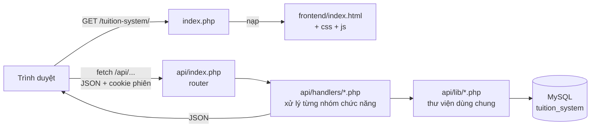
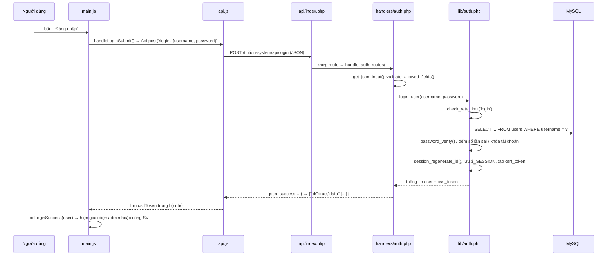
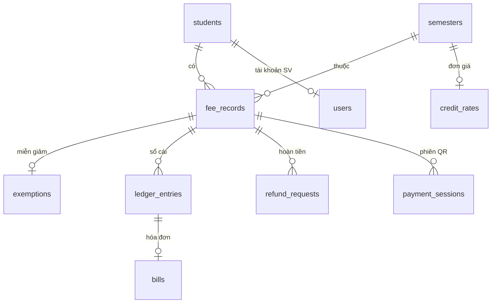
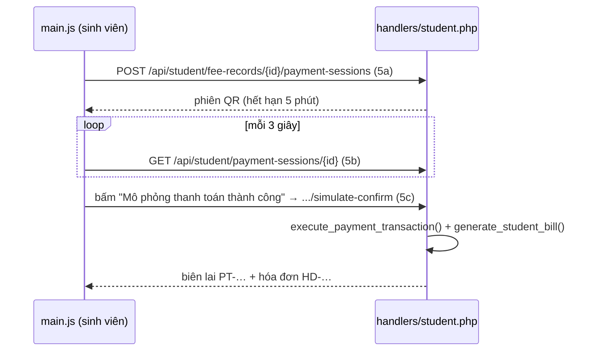

# Hướng dẫn đọc code cho người mới

Tài liệu này giúp bạn hiểu dự án **từ con số 0**: request đi từ trình duyệt tới database như thế nào, file nào làm việc gì, và nên đọc file nào trước. Cài đặt và chạy: xem [README.md](../README.md).

> Mẹo: mở song song tài liệu này với VS Code. Nhấn `Ctrl+P` rồi gõ tên file để mở nhanh, và `Ctrl+Shift+F` để tìm một tên hàm trong toàn dự án.

---

## 1. Bức tranh tổng thể

Dự án là một **SPA (Single Page Application)**: chỉ có **một trang HTML duy nhất**. JavaScript ẩn/hiện các phần của trang và gọi API để lấy/ghi dữ liệu. Backend PHP **không sinh HTML** (trừ trang `pages/` và hóa đơn tải về); nó chỉ trả **JSON**.



Có **2 loại người dùng** (cột `users.role`):

| Vai trò | Thấy gì | API dùng |
| --- | --- | --- |
| `admin` | Quản lý sinh viên, học kỳ, đơn giá, hồ sơ học phí, thu tiền, hoàn tiền, báo cáo | `/api/students`, `/api/fee-records`, `/api/refunds`... |
| `student` | Cổng sinh viên: đăng ký tín chỉ, xem nợ, thanh toán (QR/thẻ mô phỏng), lịch sử | chỉ `/api/student/...` |

---

## 2. Bản đồ thư mục

```text
tuition-system/
├── index.php              ← CỬA VÀO DUY NHẤT của giao diện: chỉ require frontend/index.html
├── .htaccess              ← Apache: chuyển /api/* vào api/index.php, chặn file nhạy cảm, header bảo mật
│
├── frontend/              ← GIAO DIỆN (chạy trên trình duyệt)
│   ├── index.html         ← toàn bộ HTML (màn hình đăng nhập, admin, cổng SV, các modal)
│   ├── css/style.css
│   └── js/
│       ├── calc.js        ← công thức tính học phí phía client (để xem trước)
│       ├── api.js         ← hàm gọi API: tự gắn CSRF token, request_id, timeout, hiển thị lỗi form
│       ├── qrcode.js      ← thư viện vẽ mã QR
│       └── main.js        ← mọi logic giao diện (≈5.200 dòng, xem mục 6)
│
├── api/                   ← BACKEND (PHP, trả JSON)
│   ├── index.php          ← ROUTER: nhìn đường dẫn → gọi handler phù hợp
│   ├── handlers/          ← mỗi file = 1 nhóm endpoint (đầu mỗi file có MỤC LỤC endpoint)
│   └── lib/               ← hàm dùng chung (kết nối DB, đăng nhập, kiểm tra dữ liệu, tính tiền...)
│
├── config/
│   ├── config.example.php ← cấu hình mẫu, CÓ GIẢI THÍCH từng mục (đọc file này)
│   └── config.php         ← cấu hình máy bạn (không đưa lên Git)
│
├── database/
│   ├── schema.sql         ← cấu trúc 15 bảng (đọc để hiểu dữ liệu)
│   ├── seed.sql           ← dữ liệu mẫu
│   ├── create_app_user.sql← tạo user MySQL cho ứng dụng
│   ├── seed_users.php     ← đặt mật khẩu cho các tài khoản mẫu
│   ├── database.sql       ← 3 file .sql trên gộp lại (tự sinh, không sửa tay)
│   └── build_database_sql.ps1 ← script sinh database.sql
│
├── pages/                 ← 2 trang tĩnh: giới thiệu, liên hệ
├── tests/                 ← kiểm thử (run.php, tests.js, perf.php, security_scan.php)
└── docs/                  ← tài liệu (bạn đang đọc)
```

---

## 3. Nên đọc theo thứ tự nào?

Đừng mở `main.js` hay `student.php` đầu tiên vì chúng rất dài. Nên đọc theo thứ tự này (khoảng 2–3 giờ):

| # | File | Đọc để hiểu | Thời gian |
| ---: | --- | --- | --- |
| 1 | [config/config.example.php](../config/config.example.php) | Hệ thống cấu hình được những gì | 5 phút |
| 2 | [database/schema.sql](../database/schema.sql) | Dữ liệu lưu ở đâu (xem mục 7) | 20 phút |
| 3 | [api/index.php](../api/index.php) | 1 request API được định tuyến thế nào | 10 phút |
| 4 | [api/lib/response.php](../api/lib/response.php) | Định dạng JSON trả về | 3 phút |
| 5 | [api/lib/config.php](../api/lib/config.php), [db.php](../api/lib/db.php) | Đọc cấu hình, kết nối DB, transaction | 10 phút |
| 6 | [api/lib/auth.php](../api/lib/auth.php), [csrf.php](../api/lib/csrf.php) | Đăng nhập, phiên, phân quyền | 20 phút |
| 7 | [api/handlers/auth.php](../api/handlers/auth.php) | Handler ngắn nhất, xem cấu trúc 1 handler | 10 phút |
| 8 | [api/lib/calc.php](../api/lib/calc.php) | Công thức học phí và trạng thái thanh toán | 15 phút |
| 9 | [api/handlers/payments.php](../api/handlers/payments.php) + [api/lib/payment.php](../api/lib/payment.php) | Nghiệp vụ quan trọng nhất: ghi một khoản thu | 30 phút |
| 10 | [frontend/js/api.js](../frontend/js/api.js) | Frontend gọi API thế nào | 15 phút |
| 11 | [frontend/js/main.js](../frontend/js/main.js), chỉ đọc `bootstrap()` (cuối file) → `checkAuthSession()` → `onLoginSuccess()` | Giao diện khởi động thế nào | 20 phút |

Sau đó, muốn hiểu chức năng nào thì mở **mục lục ở đầu handler** tương ứng (mục 5).

---

## 4. Theo dấu một request: đăng nhập

Đây là luồng nên tự lần theo đầu tiên. Mỗi bước ghi rõ file và hàm để bạn mở ra xem.



Ba điểm cần nắm:

1. **Cookie phiên** (`TUITION_SESSID`) do PHP tạo, trình duyệt tự gửi kèm mọi request sau đó. JavaScript **không đọc được** cookie này (cờ `HttpOnly`).
2. **CSRF token** trả về khi đăng nhập. `api.js` tự gắn nó vào header `X-CSRF-Token` cho mọi request ghi (POST/PUT/DELETE). Server so sánh với token trong phiên ở `verify_csrf_token()`.
3. **`json_success()` / `json_error()` gọi `exit`**. Vì vậy trong handler, gọi `json_error()` là request **dừng ngay**, không cần `return`. Đây là lý do code có nhiều `if (...) { json_error(...); }` mà không có `else`.

---

## 5. Router và handler

[api/index.php](../api/index.php) có một bảng `$routes`: mỗi dòng là `[regex của đường dẫn, tên hàm handler]`. Handler đầu tiên khớp sẽ được gọi.

Mỗi handler là **một hàm lớn** gồm nhiều khối `if (path khớp && method khớp) { ... }`. Ví dụ rút gọn:

```php
function handle_rates_routes(string $method, string $path, array $matches): void {
    require_admin();                      // 1. Kiểm tra quyền cho cả nhóm

    if ($path === '/api/rates' && $method === 'GET') {
        // 2. Đọc DB → json_success($rows)   (exit tại đây)
    }

    if ($path === '/api/rates' && $method === 'POST') {
        verify_csrf_token();              // 3. Request ghi → kiểm tra CSRF
        $input = get_json_input();        // 4. Đọc body JSON
        validate_allowed_fields($input, ['semester_id', 'price_per_credit']); // 5. Chặn trường lạ
        // 6. Kiểm tra dữ liệu → json_error(..., 400, $fields) nếu sai
        // 7. Ghi DB (thường trong db_transaction) + log_audit()
        // 8. json_success($result, 201)
    }
}
// Không khối nào khớp → handler return → router trả 405 "sai method"
```

Bảng tra nhanh (chi tiết: mục lục ở đầu từng file):

| Muốn tìm hiểu | Mở file |
| --- | --- |
| Đăng nhập, đăng xuất, `/api/me` | `api/handlers/auth.php` + `api/lib/auth.php` |
| Thêm/sửa/xóa sinh viên, cấp tài khoản SV | `api/handlers/students.php` |
| Học kỳ / đơn giá tín chỉ | `api/handlers/semesters.php` / `rates.php` |
| Hồ sơ học phí, miễn giảm, chuyển tiền thừa | `api/handlers/fees.php` |
| Thu tiền, đảo bút toán | `api/handlers/payments.php` + `api/lib/payment.php` |
| Hoàn tiền (maker-checker) | `api/handlers/refunds.php` |
| Sổ cái / báo cáo / biên lai | `history.php` / `reports.php` / `receipts.php` |
| **Toàn bộ cổng sinh viên** | `api/handlers/student.php` |

---

## 6. Frontend: đọc `main.js` thế nào?

`main.js` là một file lớn được bọc trong `(function () { ... })()` để biến không rò ra ngoài. Đọc theo bản đồ sau (số dòng là xấp xỉ):

| Dòng | Phần | Hàm chính |
| --- | --- | --- |
| 1–30 | Trạng thái ứng dụng | `AppState` (user hiện tại, tab đang mở, dữ liệu đã tải) |
| 30–490 | Tiện ích giao diện | `escapeHTML()` (**luôn dùng trước khi chèn dữ liệu vào innerHTML**), `showToast()`, `showConfirm()`, các hàm `validateClient*()` |
| 490–720 | Phiên & đăng nhập | `checkAuthSession()`, `onLoginSuccess()`, `handleLogout()`, đếm số tab đang mở |
| 720–1100 | Điều hướng | URL dạng `#students`, `#refunds/pending` → `handleRouteChange()` → `applyAdminTab()` / `applyStudentTab()` |
| 1100–3620 | Màn hình admin | mỗi màn hình có cặp `loadXxxData()` (gọi API) + `renderXxxTable()` (vẽ bảng) + `handleXxxSubmit()` (gửi form) |
| 3620–4680 | Cổng sinh viên | `loadStudentSemesters()`, `loadStudentDebts()`, `handleStudentPaymentSubmit()`, QR: `startQrSessionMonitoring()` |
| 4680–cuối | Gắn sự kiện & khởi động | `initEventListeners()` (nút nào gọi hàm nào), `bootstrap()` |

**Mẹo tìm code của một nút:** lấy `id` của nút trong `index.html` (F12 → Inspect), rồi tìm id đó trong `main.js`. Bạn sẽ thấy dòng `addEventListener('click', tenHam)`, sau đó tìm tiếp `function tenHam`.

---

## 7. Database: 15 bảng



| Bảng | Ý nghĩa |
| --- | --- |
| `students` | Sinh viên (mã SV tự viết hoa bằng trigger) |
| `users` | Tài khoản đăng nhập: `role` = admin/student; SV có `student_id` |
| `semesters` | Học kỳ, cờ mở đăng ký, hạn đóng |
| `credit_rates` | Đơn giá 1 tín chỉ của từng học kỳ |
| `fee_records` | **Hồ sơ học phí** = 1 SV × 1 học kỳ: số tín chỉ + `rate_snapshot` (đơn giá **tại thời điểm tạo**, đổi đơn giá sau đó không ảnh hưởng) |
| `exemptions` | Miễn giảm của 1 hồ sơ (% hoặc số tiền cố định) |
| `ledger_entries` | **Sổ cái**: mọi khoản thu (`payment`), đảo bút toán, chuyển tiền. **Chỉ thêm, không sửa/xóa** |
| `refund_requests` | Yêu cầu hoàn tiền: `pending` → `completed` / `cancelled` |
| `bills` | Hóa đơn của SV, lưu `snapshot` JSON bất biến |
| `receipt_counters`, `bill_counters` | Bộ đếm số biên lai `PT-…` / hóa đơn `HD-…` theo ngày |
| `payment_sessions` | Phiên thanh toán QR (hết hạn sau 5 phút) |
| `audit_log` | Nhật ký: ai làm gì, lúc nào |
| `user_nav_state` | Admin đã xem giao dịch tới đâu (cho badge "mới") |
| `student_settings` | Số tín chỉ tối thiểu/tối đa được đăng ký |

**Công thức tiền** ([api/lib/calc.php](../api/lib/calc.php)). Mọi số tiền là **số nguyên VND**, không dùng số thập phân:

```text
Học phí gốc (gross)  = số tín chỉ × rate_snapshot
Miễn giảm            = gross × % (làm tròn)  hoặc  số cố định (không vượt gross)
Phải nộp (net_due)   = gross − miễn giảm
Đã nộp (total_paid)  = tổng thu − đảo bút toán − hoàn tiền đã duyệt ± chuyển tiền
Còn nợ               = max(0, net_due − total_paid)
Thừa (overpaid)      = total_paid > net_due  → chặn thu thêm, phải hoàn hoặc chuyển
```

Trạng thái: `Chưa thanh toán` → `Thanh toán một phần` → `Đã thanh toán đủ`, cộng cờ `is_overpaid` và `Chờ duyệt` (khi có yêu cầu hoàn tiền pending).

---

## 8. Ba luồng nghiệp vụ quan trọng

### 8.1 Admin thu tiền

`main.js: handlePaymentSubmit()` → `POST /api/fee-records/{id}/payments` → `payments.php` → `db_transaction(... execute_payment_transaction(...))` trong [api/lib/payment.php](../api/lib/payment.php):

1. `SELECT ... FOR UPDATE` khóa dòng hồ sơ. Hai người thu cùng lúc thì người sau phải **chờ** người trước xong.
2. `request_id` (UUID do `api.js` tạo) đã có trong sổ cái → trả lại giao dịch cũ. Nhờ đó **bấm 2 lần không bị thu 2 lần**.
3. Tính lại số nợ **bên trong transaction**; số tiền > số nợ → từ chối.
4. Cấp số biên lai `PT-YYYYMMDD-NNNN` từ `receipt_counters` (cũng khóa dòng → không trùng số).
5. Thêm dòng vào `ledger_entries` và ghi `audit_log`. Mọi thứ COMMIT cùng lúc; lỗi ở bất kỳ bước nào → ROLLBACK toàn bộ.

### 8.2 Sinh viên thanh toán Mã QR (mô phỏng)



Hệ thống **không nối ngân hàng thật**. Nút "mô phỏng" thay cho việc ngân hàng báo đã nhận tiền. Mọi đường thanh toán của sinh viên đều phụ thuộc cờ `simulation_enabled` trong config (xem mục 9).

### 8.3 Hoàn tiền (maker-checker)

Admin A lập yêu cầu → `pending`. Admin **B (khác A)** duyệt → `completed`, số đã nộp giảm. A tự duyệt → 403 `MAKER_CHECKER_VIOLATION`. Xem `api/handlers/refunds.php`.

---

## 9. Bảo mật: những điều bạn KHÔNG được phá

Khi sửa code, giữ đúng các quy tắc sau (bộ test sẽ báo nếu bạn phá):

| Quy tắc | Ở đâu | Vì sao |
| --- | --- | --- |
| Luôn dùng prepared statement `:ten_tham_so`, **không** nối chuỗi vào SQL | mọi handler | chống SQL injection |
| Request ghi phải gọi `verify_csrf_token()` | đầu mỗi khối POST/PUT/DELETE | chống CSRF |
| `validate_allowed_fields()` với danh sách trường cho phép | sau `get_json_input()` | chặn gửi thêm trường như `role`, `student_id` |
| Cổng SV lấy `$studentId` **từ phiên**, không bao giờ từ request | `student.php` | SV A không xem/sửa được dữ liệu SV B |
| Dữ liệu người dùng → `escapeHTML()` trước khi gán `innerHTML` | `main.js` | chống XSS |
| Không viết `<script>` inline hay `onclick="..."` trong HTML | `index.html` | CSP chỉ cho chạy file `.js` của site |
| Mọi "cửa test" (header `X-...`) phải đi qua `is_test_request()` / `get_test_header()` | `api/lib/config.php` | header thì ai cũng gửi được; hàm này chỉ chấp nhận localhost |
| Mật khẩu: `hash_password()` / `password_verify()` | `api/lib/config.php` | cùng thông số bcrypt ở mọi nơi |
| Không ghi số thẻ, CVV vào DB/log | `student.php` (5e) | chỉ giữ thương hiệu + 4 số cuối |
| `simulation_enabled = false` khi dùng thật | `config/config.php` | nếu bật, SV tự xác nhận thanh toán mà không trả tiền |

---

## 10. Cách thêm một endpoint mới (ví dụ)

Giả sử cần `GET /api/semesters/{id}/summary`:

1. **Router**: nếu regex trong bảng `$routes` ở `api/index.php` chưa khớp đường dẫn mới, sửa regex. Nếu handler cần lấy `{id}` từ `$matches`, thêm regex tương ứng vào `route_params()`.
2. **Handler**: trong `handle_semesters_routes()`, thêm khối `if (preg_match('#^/api/semesters/(\d+)/summary$#', $path, $m) && $method === 'GET') { ... json_success(...); }` và cập nhật **mục lục ở đầu file**.
3. **Frontend**: gọi `Api.get('/semesters/' + id + '/summary')` trong `main.js`, rồi render bằng `escapeHTML()`.
4. **Test**: thêm vài `it("...", điều_kiện)` vào `tests/run.php`. Chạy `C:\xampp\php\php.exe tests\run.php` và phải được 100% PASS.

---

## 11. Gỡ lỗi

| Hiện tượng | Xem ở đâu |
| --- | --- |
| API trả 500 "Đã xảy ra lỗi hệ thống" | `logs/app_error.log` (có stack trace đầy đủ) |
| Không biết API trả gì | F12 → tab **Network** → bấm vào request → **Response** |
| Lỗi JavaScript | F12 → tab **Console** |
| 401 liên tục | Phiên hết hạn (30 phút) → đăng nhập lại |
| 403 `CSRF_FORBIDDEN` | Request ghi thiếu `X-CSRF-Token` (gọi qua `Api.post`, đừng dùng `fetch` trực tiếp) |
| 405 `METHOD_NOT_ALLOWED` | Đường dẫn đúng nhưng sai GET/POST/PUT/DELETE |
| Chữ tiếng Việt lỗi (Ã, á»...) | File bị lưu sai mã hóa → lưu lại UTF-8; khi import SQL chọn **utf-8** |
| Thanh toán QR/thẻ báo "đã bị vô hiệu hóa" | `simulation_enabled` đang `false` trong `config/config.php` |

---

## 12. Từ điển thuật ngữ

| Thuật ngữ | Nghĩa |
| --- | --- |
| Gross / Net due | Học phí gốc / số phải nộp sau miễn giảm |
| Ledger (sổ cái) | Bảng ghi mọi biến động tiền, chỉ thêm không sửa |
| Reversal (đảo bút toán) | Hủy 1 phiếu thu bằng cách ghi thêm 1 dòng âm đối ứng |
| Idempotency / `request_id` | Gửi cùng 1 request nhiều lần chỉ có tác dụng 1 lần |
| Maker-checker | Người lập và người duyệt phải là 2 người khác nhau |
| Snapshot | Bản chụp dữ liệu tại 1 thời điểm, không đổi theo dữ liệu gốc |
| CSRF | Tấn công lừa trình duyệt gửi request thay người dùng; chặn bằng token |
| `FOR UPDATE` | Khóa dòng DB tới khi transaction kết thúc |
| Rate limit | Giới hạn số request mỗi IP trong 1 khoảng thời gian |
