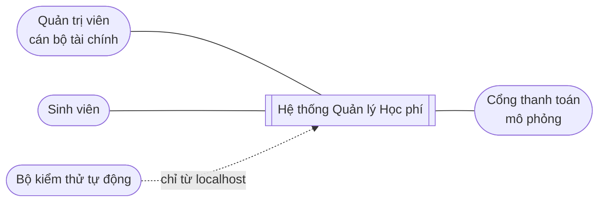
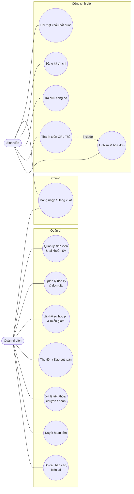
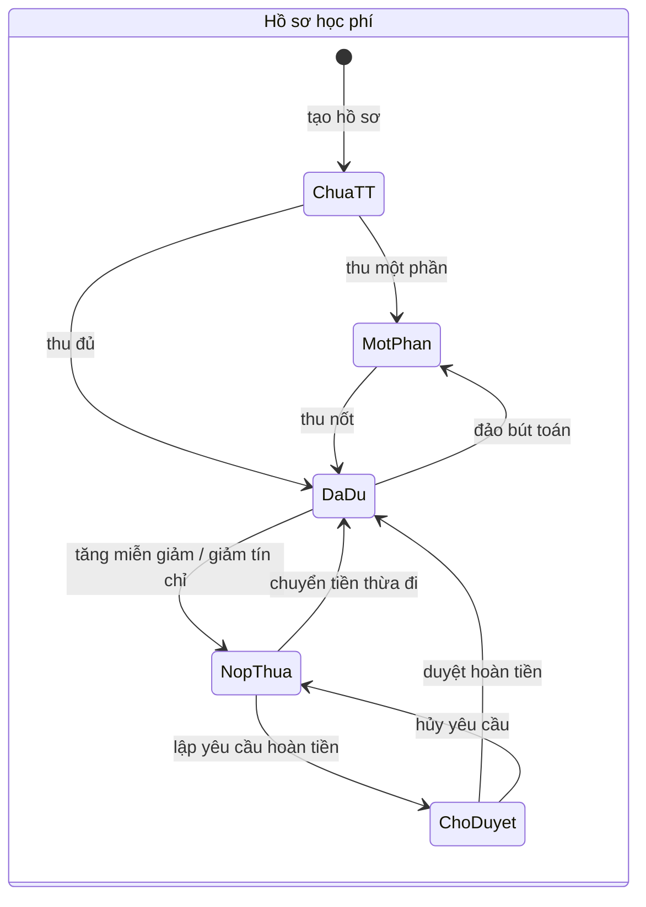
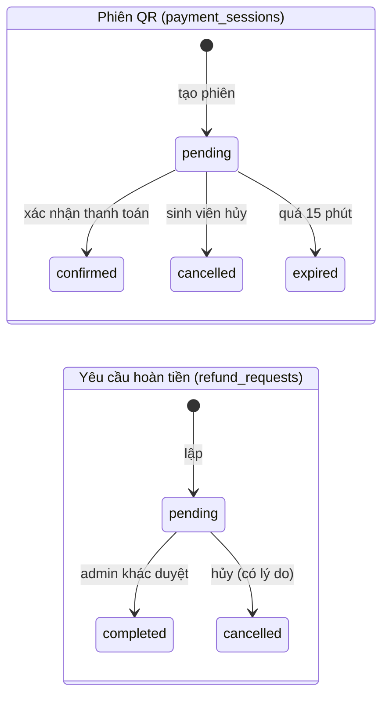
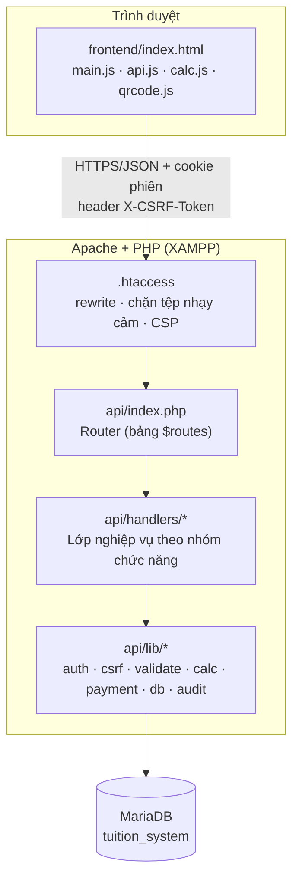
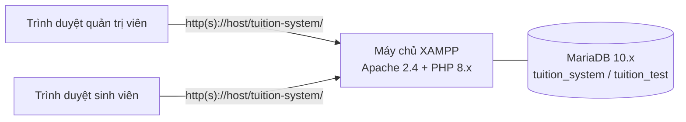
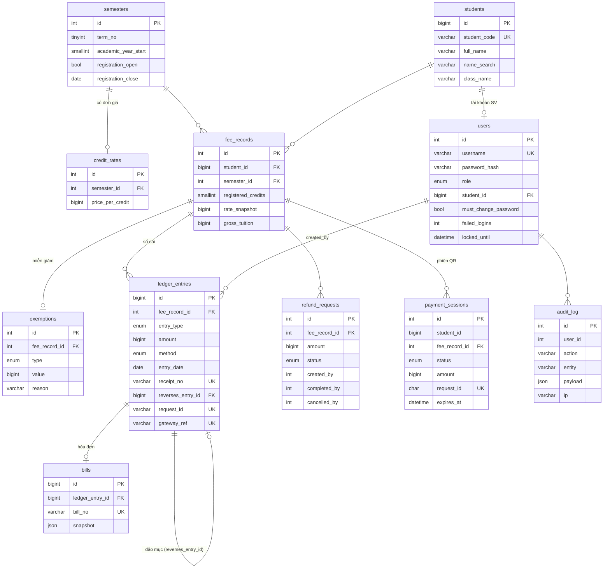
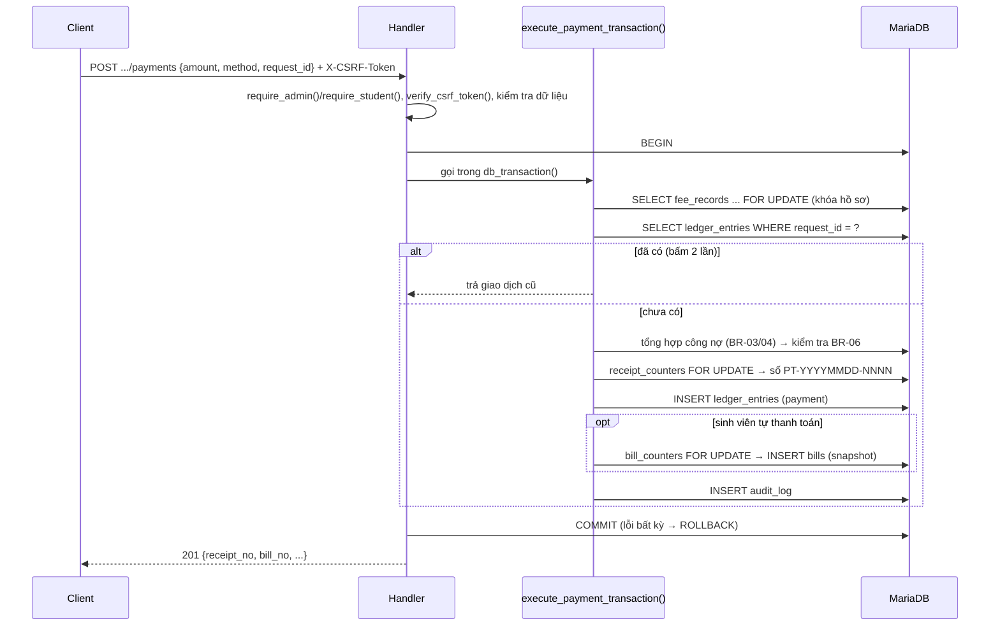
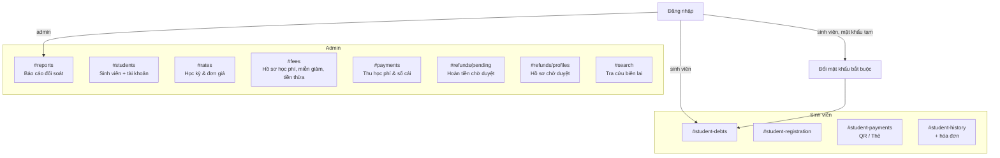

# Tài liệu Phân tích & Thiết kế — Hệ thống Quản lý Học phí Sinh viên

| | |
| --- | --- |
| Phiên bản | 1.0 — 14/11/2026 |
| Công nghệ | PHP 8.1+ (PDO), MySQL/MariaDB, HTML/CSS/JavaScript thuần, Apache (XAMPP) |
| Tài liệu liên quan | [README](../README.md) · [Đặc tả yêu cầu (NFR, BR, nghiệm thu, truy vết)](DAC_TA_YEU_CAU.md) · [ERD](ERD.md) · [Hướng dẫn đọc code](HUONG_DAN_DOC_CODE.md) · [Báo cáo kiểm thử](BAO_CAO_KIEM_THU.md) |

Tài liệu gồm hai pha: **Phân tích** (hệ thống phải làm gì) và **Thiết kế** (hệ thống làm việc đó như thế nào). Mục cuối là ma trận truy vết, nối mỗi yêu cầu với API và bộ kiểm thử tương ứng.

---

# PHẦN I — PHA PHÂN TÍCH

## 1. Bối cảnh, mục tiêu và phạm vi

### 1.1 Bối cảnh

Phòng Kế hoạch – Tài chính của trường cần quản lý học phí theo tín chỉ cho từng sinh viên, từng học kỳ. Hiện tượng thường gặp khi làm thủ công trên bảng tính:

- Sai số khi tính miễn giảm, làm tròn tiền.
- Thu trùng khi một phiếu bị nhập hai lần.
- Không truy vết được ai đã sửa hoặc hủy khoản thu.
- Sinh viên phải đến phòng tài chính mới biết mình còn nợ bao nhiêu.

### 1.2 Mục tiêu

| Mã | Mục tiêu |
| --- | --- |
| G1 | Tính học phí tự động, chính xác đến từng đồng theo tín chỉ, đơn giá và miễn giảm |
| G2 | Ghi nhận mọi biến động tiền vào sổ cái không thể sửa/xóa, truy vết đầy đủ |
| G3 | Ngăn thu trùng, thu vượt và các sai lệch do nhiều người thao tác cùng lúc |
| G4 | Cho sinh viên tự tra cứu công nợ, đăng ký tín chỉ và thanh toán trực tuyến |
| G5 | Đối soát được: Đã thu + Còn phải thu = Tổng phải thu |

### 1.3 Phạm vi

| Trong phạm vi | Ngoài phạm vi |
| --- | --- |
| Quản lý sinh viên, học kỳ, đơn giá tín chỉ, hồ sơ học phí, miễn giảm | Quản lý đào tạo (môn học, lớp học phần, điểm) |
| Thu tiền tại quầy, đảo bút toán, chuyển tiền thừa, hoàn tiền | Kết nối ngân hàng/cổng thanh toán thật (chỉ **mô phỏng**) |
| Biên lai, hóa đơn điện tử, báo cáo đối soát, nhật ký kiểm toán | Xuất hóa đơn điện tử theo chuẩn cơ quan thuế |
| Cổng sinh viên với 4 chức năng | Nhiều đơn vị đào tạo (multi-tenant) |

## 2. Tác nhân

| Tác nhân | Mô tả | Quyền |
| --- | --- | --- |
| **Quản trị viên** (`role = admin`) | Cán bộ phòng tài chính. Có thể có nhiều người; quy trình hoàn tiền bắt buộc 2 người khác nhau | Toàn bộ chức năng quản trị; **không** vào được cổng sinh viên |
| **Sinh viên** (`role = student`) | Có tài khoản do quản trị viên cấp, gắn với đúng 1 hồ sơ sinh viên | Chỉ 4 chức năng của cổng sinh viên, chỉ trên dữ liệu của chính mình |
| **Cổng thanh toán mô phỏng** | Thay thế ngân hàng/đơn vị xử lý thẻ: QR luôn có nút "xác nhận", thẻ duyệt theo số thẻ kiểm thử | Bật/tắt bằng `simulation_enabled` |
| **Bộ kiểm thử** | `tests/*.php`, gửi header `X-Tuition-Test-Db` để dùng database riêng `tuition_test` | Chỉ được chấp nhận khi gọi từ chính máy chủ |

## 3. Yêu cầu chức năng

### 3.1 Xác thực & tài khoản

| Mã | Yêu cầu |
| --- | --- |
| FR-01 | Đăng nhập bằng tên đăng nhập + mật khẩu; thông báo lỗi chung, không tiết lộ tài khoản có tồn tại hay không |
| FR-02 | Khóa tài khoản 15 phút sau 5 lần sai mật khẩu liên tiếp |
| FR-03 | Đăng xuất; tự đăng xuất sau 30 phút không thao tác, tối đa 8 giờ, và khi đóng tab cuối cùng |
| FR-04 | Quản trị viên cấp tài khoản cho sinh viên (username = mã SV viết thường, mật khẩu tạm 12 ký tự ngẫu nhiên); mỗi sinh viên tối đa 1 tài khoản |
| FR-05 | Quản trị viên đặt lại mật khẩu tạm cho sinh viên |
| FR-06 | Sinh viên đăng nhập bằng mật khẩu tạm **bắt buộc đổi mật khẩu** trước khi dùng chức năng khác (≥ 8 ký tự, có chữ và số, khác mật khẩu cũ) |

### 3.2 Danh mục (quản trị viên)

| Mã | Yêu cầu |
| --- | --- |
| FR-10 | Thêm/sửa/xóa/tìm sinh viên. Mã SV 6–12 ký tự chữ số, tự viết hoa, không trùng. Tìm kiếm không phân biệt dấu và hoa thường (`nguyen` tìm được `Nguyễn`) |
| FR-11 | Không xóa được sinh viên đã có hồ sơ học phí |
| FR-12 | Thêm/sửa/xóa học kỳ (học kỳ 1–3, năm học). Cờ mở đăng ký và hạn đóng đăng ký lưu ở bảng `semesters`, hiện chưa có giao diện/API để sửa (AS-08) |
| FR-13 | Đặt đơn giá 1 tín chỉ cho từng học kỳ; không xóa được học kỳ/đơn giá đã có hồ sơ |

### 3.3 Học phí & thu tiền (quản trị viên)

| Mã | Yêu cầu |
| --- | --- |
| FR-20 | Tạo hồ sơ học phí cho 1 sinh viên × 1 học kỳ (không trùng); hệ thống chụp đơn giá tại thời điểm tạo |
| FR-21 | Sửa số tín chỉ của hồ sơ (1–60); học phí gốc được tính lại |
| FR-22 | Đặt/bỏ miễn giảm theo % (1–100) hoặc số tiền cố định, kèm lý do |
| FR-23 | Ghi phiếu thu (Tiền mặt, Chuyển khoản, Thẻ); cấp số biên lai `PT-YYYYMMDD-NNNN`; không cho ngày thu ở tương lai |
| FR-24 | Đảo (hủy) phiếu thu, bắt buộc có lý do |
| FR-25 | Chuyển tiền nộp thừa từ hồ sơ này sang hồ sơ khác **của cùng sinh viên** |
| FR-26 | Lập yêu cầu hoàn tiền nộp thừa; **một quản trị viên khác** duyệt hoặc hủy (hủy cần lý do) |
| FR-27 | Xem, tra cứu, in biên lai (số tiền bằng số và bằng chữ tiếng Việt) |

### 3.4 Báo cáo & giám sát (quản trị viên)

| Mã | Yêu cầu |
| --- | --- |
| FR-30 | Sổ cái giao dịch, lọc theo khoảng ngày, học kỳ, loại giao dịch |
| FR-31 | Báo cáo đối soát: tổng phải thu, đã thu, còn nợ, số hồ sơ theo trạng thái; hiển thị "Khớp 100%" khi cân bằng |
| FR-32 | Badge trên menu báo số giao dịch mới, hồ sơ nộp thừa, yêu cầu hoàn tiền chờ duyệt |
| FR-33 | Ghi nhật ký kiểm toán cho mọi thao tác ghi và đăng nhập |

### 3.5 Cổng sinh viên

| Mã | Yêu cầu |
| --- | --- |
| FR-40 | Đăng ký tín chỉ cho học kỳ đang mở (số tín chỉ trong khoảng cấu hình, mặc định 1–30); xem trước học phí; chỉ được sửa khi chưa nộp tiền |
| FR-41 | Tra cứu công nợ tất cả học kỳ: tổng nợ, các học kỳ còn nợ, chi tiết từng hồ sơ |
| FR-42 | Thanh toán bằng **Mã QR**: tạo phiên 15 phút, tự kiểm tra trạng thái mỗi 3 giây, hủy phiên, xác nhận (mô phỏng) |
| FR-43 | Thanh toán bằng **thẻ Visa/Mastercard** (mô phỏng): kiểm tra Luhn, hạn thẻ, CVV; không bao giờ lưu số thẻ đầy đủ/CVV |
| FR-44 | Sau mỗi thanh toán thành công sinh **hóa đơn** `HD-YYYYMMDD-NNNN`; xem, tải (HTML), in |
| FR-45 | Lịch sử thanh toán và số dư lũy kế từng học kỳ; lọc khoảng ngày (≤ 5 năm, "đến" ≥ "từ") |

## 4. Yêu cầu phi chức năng

> Bảng dưới là tóm tắt. Bản đầy đủ có chỉ tiêu đo được và kết quả đo, chia theo Bảo mật / Hiệu năng / Khả dụng / Bản địa hóa / Tin cậy: [DAC_TA_YEU_CAU.md §1](DAC_TA_YEU_CAU.md#1-yêu-cầu-phi-chức-năng).

| Mã | Loại | Yêu cầu | Cách kiểm chứng |
| --- | --- | --- | --- |
| NFR-01 | Hiệu năng | Với 1 người dùng, **mọi thao tác phản hồi < 200 ms** | `tests/perf.php`: thao tác chậm nhất 107 ms (đăng nhập) |
| NFR-02 | Bảo mật | Chống SQL injection, XSS, CSRF, session fixation; phân quyền ở phía máy chủ | `tests/security_scan.php` (63 PASS), `tests/run.php` nhóm 13, 22, 31 |
| NFR-03 | Bảo mật | Mật khẩu băm bcrypt; không lộ thông tin lỗi nội bộ; giới hạn 30 lần đăng nhập/phút/IP | như trên |
| NFR-04 | Toàn vẹn | Mọi thao tác tiền là giao dịch nguyên tử (ACID); không thu trùng khi bấm 2 lần hay khi 2 người thu cùng lúc | `run.php` nhóm 7, 9 |
| NFR-05 | Truy vết | Sổ cái và nhật ký chỉ thêm, không sửa/xóa | thiết kế CSDL (mục 9) |
| NFR-06 | Chính xác | Tiền là số nguyên VND, không dùng số thực; làm tròn miễn giảm % đến đồng | `run.php` nhóm 1, 3 |
| NFR-07 | Khả dụng | Giao diện tiếng Việt; lỗi hiển thị ngay dưới ô nhập; responsive đến 360 px | checklist thủ công trong README |
| NFR-08 | Triển khai | Chạy được trên XAMPP, không cần npm, framework hay CDN | — |
| NFR-09 | Bảo trì | Có kiểm thử tự động tái lập được (database riêng, dữ liệu mẫu cố định) | `run.php`: 346 test |

## 5. Quy tắc nghiệp vụ

> Bảng dưới là tóm tắt (BR-01…14). Danh sách chính thức, chi tiết hơn, có công thức suy ra trạng thái: [DAC_TA_YEU_CAU.md §2](DAC_TA_YEU_CAU.md#2-quy-tắc-nghiệp-vụ) (BR-001…BR-061).

| Mã | Quy tắc |
| --- | --- |
| BR-01 | **Học phí gốc** = số tín chỉ × đơn giá **snapshot** (chụp lúc tạo hồ sơ; đổi đơn giá sau đó không ảnh hưởng hồ sơ cũ) |
| BR-02 | **Miễn giảm** % = làm tròn(gốc × % / 100); cố định = min(số tiền, gốc). **Phải nộp** = max(0, gốc − miễn giảm) |
| BR-03 | **Đã nộp** = Σ thu − Σ đảo bút toán − Σ hoàn tiền đã duyệt − Σ chuyển đi + Σ nhận chuyển |
| BR-04 | **Còn nợ** = max(0, phải nộp − đã nộp); **nộp thừa** khi đã nộp > phải nộp |
| BR-05 | Trạng thái: *Chưa thanh toán* (đã nộp = 0) → *Thanh toán một phần* → *Đã thanh toán đủ*; cờ *Nộp thừa*; *Chờ duyệt* khi nộp thừa và có yêu cầu hoàn tiền đang chờ |
| BR-06 | Số tiền thu không được vượt số còn nợ; hồ sơ đang nộp thừa không nhận thêm tiền |
| BR-07 | Mỗi yêu cầu ghi tiền mang một `request_id` (UUID); gửi lại cùng `request_id` trả về kết quả cũ, không ghi thêm |
| BR-08 | Số biên lai `PT-` và số hóa đơn `HD-` liên tục theo ngày, không trùng, không nhảy số; mỗi ngày bắt đầu từ `0001` |
| BR-09 | Chỉ đảo được phiếu thu (`payment`), mỗi phiếu tối đa 1 lần, và không đảo được phần tiền đã hoàn/chuyển đi |
| BR-10 | Chuyển tiền: cùng sinh viên, khác hồ sơ, không vượt số thừa khả dụng của nguồn và số nợ của đích |
| BR-11 | Hoàn tiền không vượt số nộp thừa; **người duyệt ≠ người lập** (maker-checker) |
| BR-12 | Sinh viên chỉ đăng ký được học kỳ đang mở và chưa quá hạn; không sửa tín chỉ khi đã nộp tiền |
| BR-13 | Sinh viên không thanh toán bằng "Tiền mặt"; phiên QR hết hạn sau 15 phút |
| BR-14 | Hóa đơn là bản chụp bất biến tại thời điểm thanh toán; chỉ lưu thương hiệu + 4 số cuối thẻ |

## 6. Mô hình ca sử dụng

### 6.1 Đặc tả UC4 — Thu tiền tại quầy

| Mục | Nội dung |
| --- | --- |
| Tác nhân | Quản trị viên |
| Tiền điều kiện | Đã đăng nhập; hồ sơ học phí tồn tại và còn nợ |
| Luồng chính | 1. Chọn hồ sơ → hệ thống hiển thị phải nộp, đã nộp, còn nợ. 2. Nhập số tiền, phương thức, ngày, ghi chú. 3. Bấm "Ghi nhận phiếu thu" (nút bị khóa trong lúc xử lý). 4. Hệ thống kiểm tra lại số nợ, ghi sổ cái, cấp số biên lai. 5. Hiển thị biên lai để in |
| Luồng thay thế | 4a. Số tiền > còn nợ → từ chối, gợi ý lập yêu cầu hoàn tiền (BR-06). 4b. Ngày thu ở tương lai → lỗi dưới ô ngày. 4c. Bấm 2 lần / mạng gửi lại → trả về phiếu đã ghi (BR-07). 4d. Mất kết nối → giữ nguyên dữ liệu trên form, báo lỗi tiếng Việt |
| Hậu điều kiện | 1 dòng `payment` mới trong sổ cái + 1 dòng nhật ký; trạng thái hồ sơ cập nhật |

### 6.2 Đặc tả UC11 — Sinh viên thanh toán bằng Mã QR

| Mục | Nội dung |
| --- | --- |
| Tác nhân | Sinh viên, Cổng thanh toán mô phỏng |
| Tiền điều kiện | Đã đăng nhập, đã đổi mật khẩu tạm; hồ sơ của chính sinh viên còn nợ; `simulation_enabled = true` |
| Luồng chính | 1. Chọn hồ sơ, chọn "Mã QR", nhập số tiền. 2. Hệ thống tạo phiên (hết hạn 15 phút) và hiển thị mã QR + đồng hồ đếm ngược. 3. Giao diện kiểm tra trạng thái mỗi 3 giây. 4. Sinh viên bấm "Mô phỏng thanh toán thành công" (thay cho ngân hàng báo có). 5. Hệ thống ghi khoản thu, cấp biên lai và hóa đơn. 6. Hiển thị "Thanh toán thành công" kèm nút xem/tải/in hóa đơn |
| Luồng thay thế | 2a. Số tiền > còn nợ hoặc hồ sơ nộp thừa → từ chối. 3a. Quá 15 phút → phiên `expired`, yêu cầu tạo mã mới. 3b. Sinh viên bấm "Hủy phiên" → `cancelled`. 4a. Phiên đã xác nhận/hủy → từ chối xác nhận lần 2 |
| Hậu điều kiện | Phiên `confirmed`, 1 dòng sổ cái `Mã QR`, 1 hóa đơn bất biến |

### 6.3 Đặc tả UC5/UC6 — Hoàn tiền nộp thừa

| Mục | Nội dung |
| --- | --- |
| Tác nhân | Quản trị viên A (lập), Quản trị viên B (duyệt) |
| Tiền điều kiện | Hồ sơ đang nộp thừa (ví dụ do thêm miễn giảm sau khi đã nộp đủ) |
| Luồng chính | 1. A mở "Xử lý số tiền thừa", chọn hoàn tiền, nhập số tiền ≤ số thừa và lý do → yêu cầu `pending`, hồ sơ hiện "Chờ duyệt". 2. B mở "Hoàn tiền chờ duyệt", bấm Duyệt. 3. Hệ thống kiểm tra lại số thừa, chuyển `completed`, giảm số đã nộp |
| Luồng thay thế | 2a. A tự duyệt → từ chối 403 (BR-11). 2b. B hủy kèm lý do → `cancelled`, số thừa khả dụng trở lại. 3a. Số thừa không còn đủ (đã chuyển đi) → từ chối |

## 7. Mô hình trạng thái

---

# PHẦN II — PHA THIẾT KẾ

## 8. Kiến trúc hệ thống

### 8.1 Kiểu kiến trúc

Ứng dụng **3 lớp**, giao diện dạng **SPA** (Single Page Application) gọi **REST API trả JSON**:

| Lớp | Thành phần | Trách nhiệm |
| --- | --- | --- |
| Trình bày | `frontend/` | Hiển thị, điều hướng bằng hash (`#students`, `#refunds/pending`...), kiểm tra dữ liệu sơ bộ, gọi API |
| Nghiệp vụ | `api/handlers/`, `api/lib/calc.php`, `api/lib/payment.php` | Phân quyền, kiểm tra dữ liệu, áp dụng quy tắc BR-xx, giao dịch |
| Dữ liệu | `api/lib/db.php`, MariaDB | Kết nối PDO, transaction, ràng buộc toàn vẹn |

**Lý do chọn:** dự án yêu cầu chạy trên XAMPP không có bước build (NFR-08). Vì vậy dùng PHP thuần với front controller thay cho framework, và JavaScript thuần thay cho React/Vue. Mọi quyết định bảo mật và tính tiền đều nằm ở máy chủ; phía client chỉ tính để **xem trước**.

### 8.2 Triển khai

Ứng dụng kết nối DB bằng tài khoản quyền tối thiểu `tuition_user` (chỉ SELECT/INSERT/UPDATE/DELETE, không DROP/ALTER).

## 9. Thiết kế cơ sở dữ liệu

### 9.1 Sơ đồ thực thể – liên kết

> Từ điển dữ liệu đầy đủ (mọi cột, kiểu, ràng buộc, lực lượng quan hệ): [ERD.md](ERD.md).

Bảng phụ: `receipt_counters`, `bill_counters` (bộ đếm số chứng từ theo ngày), `user_nav_state` (mốc "đã xem" cho badge), `student_settings` (1 dòng: số tín chỉ tối thiểu/tối đa).

### 9.2 Quyết định thiết kế dữ liệu

| Quyết định | Lý do | Hiện thực |
| --- | --- | --- |
| **Tiền là `BIGINT` (VND nguyên)** | Tránh sai số số thực (NFR-06) | Mọi cột tiền; `CHECK (amount > 0)` |
| **Sổ cái chỉ thêm** | Truy vết (G2): hủy phiếu = thêm dòng `reversal` trỏ về dòng gốc, không UPDATE/DELETE | `ledger_entries.reverses_entry_id UNIQUE` → mỗi phiếu đảo tối đa 1 lần (BR-09) |
| **Không lưu "đã nộp", "còn nợ"** | Tránh lệch số liệu; luôn tính từ sổ cái | `get_fee_summary_subquery()` tổng hợp theo BR-03, BR-04 |
| **Snapshot đơn giá** | Đổi đơn giá không làm đổi hồ sơ cũ (BR-01) | `fee_records.rate_snapshot`, `gross_tuition` |
| **Hóa đơn là snapshot JSON** | Hóa đơn phải bất biến dù dữ liệu gốc thay đổi (BR-14) | `bills.snapshot` |
| **Idempotency bằng ràng buộc** | Bấm 2 lần không tạo 2 dòng, kể cả khi 2 request đến cùng lúc | `request_id UNIQUE`; trùng → trả dòng cũ (BR-07) |
| **Bộ đếm chứng từ theo ngày** | Số liên tục, không trùng khi đồng thời (BR-08) | `receipt_counters`/`bill_counters` + `SELECT ... FOR UPDATE` |
| **Ràng buộc ở mức CSDL** | Lớp bảo vệ cuối cùng nếu code có lỗi | `uq_fee_student_semester`, `chk_user_role`, `chk_exemption_value`, khóa ngoại `RESTRICT` (FR-11, FR-13) |
| **Mã SV tự viết hoa** | Nhập `sv013` vẫn lưu `SV013` | Trigger `trg_students_before_insert/update` |
| **Cột `name_search`** | Tìm kiếm không dấu nhanh bằng `LIKE` | Sinh bằng `generate_name_search()` khi thêm/sửa |

## 10. Thiết kế API

### 10.1 Quy ước

| Hạng mục | Quy ước |
| --- | --- |
| Định dạng | JSON UTF-8. Thành công: `{"ok": true, "data": ...}`. Lỗi: `{"ok": false, "error": {"code", "message", "fields"}}` |
| Mã HTTP | 200/201 thành công · 400 dữ liệu sai · 401 chưa đăng nhập/hết phiên · 403 sai quyền/CSRF/chưa đổi mật khẩu · 404 không có (hoặc không thuộc quyền) · 405 sai method · 409 trùng/xung đột trạng thái · 422 vi phạm quy tắc nghiệp vụ · 429 quá nhiều request · 502 cổng thanh toán lỗi |
| Xác thực | Cookie phiên `TUITION_SESSID` (HttpOnly, SameSite=Strict) |
| Chống CSRF | Mọi POST/PUT/DELETE gửi header `X-CSRF-Token` |
| Chống trường lạ | Mỗi endpoint có danh sách trường cho phép; trường lạ → 400 |
| Lỗi theo trường | `error.fields` = `{tên_trường: thông báo}` để giao diện hiện lỗi dưới đúng ô |

### 10.2 Danh sách endpoint

| Nhóm | Endpoint | Quyền | Yêu cầu |
| --- | --- | --- | --- |
| Phiên | `POST /api/login` · `POST /api/logout` · `POST /api/logout-beacon` · `GET /api/me` · `GET /api/csrf` | Công khai / đã đăng nhập | FR-01..03 |
| Sinh viên | `GET/POST /api/students` · `GET /api/students/search` · `GET/PUT/DELETE /api/students/{id}` | Admin | FR-10, FR-11 |
| Tài khoản SV | `GET/POST /api/students/{id}/account` · `POST .../account/reset` | Admin | FR-04, FR-05 |
| Học kỳ, đơn giá | `GET/POST /api/semesters` · `PUT/DELETE /api/semesters/{id}` · `GET/POST /api/rates` · `PUT/DELETE /api/rates/{id}` | Admin | FR-12, FR-13 |
| Hồ sơ học phí | `GET/POST /api/fee-records` · `GET/PUT /api/fee-records/{id}` · `PUT/DELETE .../exemption` | Admin | FR-20..22 |
| Tiền | `POST /api/fee-records/{id}/payments` · `POST /api/ledger/{id}/reversal` · `POST /api/fee-records/{id}/transfers` | Admin | FR-23..25 |
| Hoàn tiền | `GET /api/refunds` · `POST /api/fee-records/{id}/refunds` · `POST /api/refunds/{id}/complete` · `POST /api/refunds/{id}/cancel` | Admin | FR-26 |
| Báo cáo | `GET /api/history` · `GET /api/reports/summary` · `GET /api/receipts/{số}` · `GET /api/nav/badges` · `POST /api/nav/seen` | Admin (biên lai: cả SV) | FR-27, FR-30..32 |
| Cổng SV | `POST /api/student/password` · `GET /api/student/semesters` · `POST /api/student/registrations` · `PUT /api/student/registrations/{semesterId}` | Sinh viên | FR-06, FR-40 |
| Cổng SV | `GET /api/student/debts` · `GET /api/student/history` · `GET /api/student/bills/{id}[/download]` | Sinh viên | FR-41, FR-44, FR-45 |
| Thanh toán SV | `POST .../fee-records/{id}/payment-sessions` · `GET /api/student/payment-sessions/{id}` · `POST .../simulate-confirm` · `POST .../cancel` · `POST .../fee-records/{id}/card-payments` | Sinh viên | FR-42, FR-43 |

Chi tiết từng endpoint xem mục lục ở đầu mỗi tệp trong `api/handlers/`.

## 11. Thiết kế module

| Module | Tệp | Chức năng chính | Phụ thuộc |
| --- | --- | --- | --- |
| Cấu hình | `api/lib/config.php` | `app_config()`, `is_test_request()`, `hash_password()` | — |
| Phản hồi | `api/lib/response.php` | `json_success()`, `json_error()` (kết thúc request) | — |
| Dữ liệu | `api/lib/db.php` | `get_db_connection()`, `db_transaction()` (rollback, thử lại khi deadlock) | config |
| Xác thực | `api/lib/auth.php`, `csrf.php`, `rate_limit.php` | `login_user()`, `start_session_safe()`, `require_admin()`, `require_student()`, `verify_csrf_token()` | db, audit |
| Kiểm tra dữ liệu | `api/lib/validate.php` | Đọc JSON, chặn trường lạ, chuẩn hóa tiếng Việt, kiểm tra tiền/ngày/thẻ | response |
| Tính toán | `api/lib/calc.php` | Công thức BR-01..05, truy vấn tổng hợp công nợ, đọc số thành chữ | — |
| Thanh toán | `api/lib/payment.php`, `payment_gateway.php` | `execute_payment_transaction()`, `generate_student_bill()`, cổng mô phỏng | db, calc, audit |
| Kiểm toán | `api/lib/audit.php` | `log_audit()` | db |
| Giao diện | `frontend/js/api.js` | Gọi API, gắn CSRF, sinh `request_id`, timeout 15 s, hiển thị lỗi theo trường | — |
| Giao diện | `frontend/js/main.js` | Màn hình, điều hướng, sự kiện | api.js, calc.js |

**Nguyên tắc:** chỉ một hàm duy nhất ghi khoản thu, là `execute_payment_transaction()`. Bốn luồng (admin thu, QR, thẻ, endpoint cũ) đều gọi hàm này, nên các quy tắc BR-06..08 chỉ được viết **một lần**.

## 12. Thiết kế luồng xử lý quan trọng

### 12.1 Ghi một khoản thu (dùng chung)

### 12.2 Xử lý đồng thời

| Tình huống | Cơ chế |
| --- | --- |
| 2 quản trị viên thu cùng 1 hồ sơ, số nợ chỉ đủ cho 1 | `FOR UPDATE` trên hồ sơ: người thứ 2 chờ, rồi thấy số nợ mới và bị từ chối (đã kiểm thử bằng 2 tiến trình PHP song song) |
| 2 khoản thu cùng ngày | `FOR UPDATE` trên dòng bộ đếm → số biên lai không trùng |
| Cùng `request_id` đến đồng thời | `UNIQUE(request_id)`: request đến sau gặp lỗi trùng khóa → đọc lại và trả về dòng đã ghi |
| Deadlock | `db_transaction()` rollback, chờ 50 ms, thử lại 1 lần |

## 13. Thiết kế bảo mật

| Mối đe dọa | Biện pháp | Vị trí |
| --- | --- | --- |
| SQL injection | Prepared statement thật (`ATTR_EMULATE_PREPARES = false`) cho mọi truy vấn | `db.php`, handlers |
| XSS | `escapeHTML()` trước mọi `innerHTML`; CSP `script-src 'self'` (không script inline) | `main.js`, `.htaccess` |
| CSRF | Token ngẫu nhiên 256 bit theo phiên + `SameSite=Strict` | `csrf.php` |
| Đánh cắp phiên | Cookie `HttpOnly`, `Secure` khi HTTPS; đổi session id sau đăng nhập; hết hạn 30 phút/8 giờ | `auth.php` |
| Dò mật khẩu | Khóa 15 phút sau 5 lần sai; 30 lần/phút/IP; bcrypt | `auth.php`, `rate_limit.php` |
| Dò tài khoản | Cùng thông báo lỗi; hash giả cùng cost → thời gian phản hồi như nhau | `config.php` |
| Leo quyền / xem dữ liệu người khác | Kiểm tra vai trò ở máy chủ; SV chỉ truy vấn theo `student_id` **trong phiên**; dữ liệu người khác → 404 | `require_*()`, `student.php` |
| Gán trường trái phép | Danh sách trường cho phép cho mỗi endpoint | `validate_allowed_fields()` |
| Lộ thông tin | Lỗi 500 chỉ trả thông báo chung, chi tiết ghi `logs/`; chặn truy cập `config/`, `database/`, `logs/`, tệp ẩn | `api/index.php`, `.htaccess` |
| Lạm dụng cửa test | Header test chỉ được chấp nhận từ localhost | `is_test_request()` |
| Thanh toán giả khi dùng thật | Mọi kênh mô phỏng phụ thuộc `simulation_enabled` (mặc định tắt) | `require_simulation_enabled()` |
| Lộ dữ liệu thẻ | Chỉ lưu thương hiệu + 4 số cuối; xóa ô nhập thẻ ngay khi gửi | `student.php`, `main.js` |

## 14. Thiết kế giao diện

### 14.1 Bản đồ màn hình

### 14.2 Nguyên tắc giao diện

- **Một trang, nhiều khung:** điều hướng bằng hash URL nên nút Back/Forward của trình duyệt hoạt động; route không hợp lệ → về màn hình mặc định kèm thông báo.
- **Mẫu lặp cho mỗi màn hình:** `loadXxx()` gọi API → `renderXxx()` vẽ bảng → `handleXxxSubmit()` gửi form → tải lại dữ liệu.
- **Lỗi tại chỗ:** viền đỏ + thông báo ngay dưới ô nhập, tự focus ô lỗi đầu tiên; lỗi chung hiện ở banner/toast.
- **Chống thao tác lặp:** nút gửi bị khóa trong lúc chờ; mỗi lần gửi kèm `request_id` mới.
- **Modal xác nhận** cho thao tác không hoàn tác được (xóa, đảo bút toán, duyệt hoàn tiền).
- **In ấn:** `@media print` chỉ in mẫu biên lai/hóa đơn khổ A4.

## 15. Thiết kế kiểm thử

| Cấp | Công cụ | Phạm vi | Kết quả (14/11/2026) |
| --- | --- | --- | --- |
| Đơn vị (client) | `tests/tests.js` (`?test=1`) | Công thức `calc.js` | 30/30 |
| Tích hợp API | `tests/run.php` | 34 nhóm: nghiệp vụ, biên, đồng thời, bảo mật, dữ liệu mẫu, rate limit | 346/346 |
| Hiệu năng | `tests/perf.php` | 37 thao tác đọc/ghi, ngưỡng 200 ms; tải đồng thời (tham khảo) | Đạt, chậm nhất 107 ms |
| Bảo mật | `tests/security_scan.php` | 64 kiểm tra black-box | 63 PASS, 0 FAIL |
| Thủ công | Checklist trong README | Giao diện, in ấn, đóng tab, responsive | — |

## 16. Ma trận truy vết

> Bảng dưới truy vết theo **nhóm** test. Truy vết tới từng **mã test** (TC-SS-NN, FE-NN): [DAC_TA_YEU_CAU.md §5](DAC_TA_YEU_CAU.md#5-ma-trận-truy-vết-fr--test-chức-năng).

| Yêu cầu | API chính | Quy tắc | Kiểm thử (`run.php` nhóm / tệp) |
| --- | --- | --- | --- |
| FR-01, FR-02 | `/api/login` | — | 13, 24; security_scan [7] |
| FR-03 | `/api/logout`, `/api/logout-beacon` | — | 31 |
| FR-04..06 | `/api/students/{id}/account`, `/api/student/password` | — | 22 |
| FR-10, FR-11 | `/api/students` | — | 10, 11, 19, 29 |
| FR-20..22 | `/api/fee-records`, `.../exemption` | BR-01, BR-02 | 1, 4, 16, 18 |
| FR-23 | `.../payments` | BR-06..08 | 2, 3, 7, 8, 9, 14, 15 |
| FR-24 | `/api/ledger/{id}/reversal` | BR-09 | 6, 17 |
| FR-25 | `.../transfers` | BR-10 | 16 |
| FR-26 | `/api/refunds/...` | BR-11 | 5, 16, 21 |
| FR-30, FR-31 | `/api/history`, `/api/reports/summary` | BR-03..05 | 12, 25, 27 |
| FR-32 | `/api/nav/badges` | — | 20 |
| FR-40 | `/api/student/registrations` | BR-12 | 22 |
| FR-41, FR-45 | `/api/student/debts`, `/api/student/history` | BR-04 | 22, 26 |
| FR-42, FR-43 | `.../payment-sessions`, `.../card-payments` | BR-06, BR-13 | 28 |
| FR-44 | `/api/student/bills/{id}` | BR-14 | 30, 32 |
| NFR-01 | toàn bộ | — | `tests/perf.php` |
| NFR-02, NFR-03 | toàn bộ | — | 13, 22, 31; `tests/security_scan.php` |
| NFR-04 | `.../payments` | BR-07 | 7, 9 |
